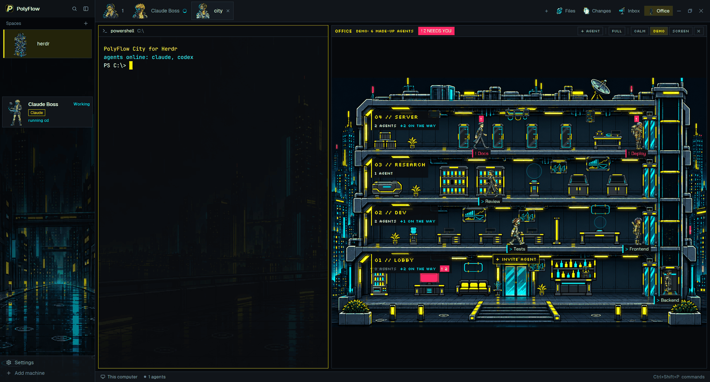
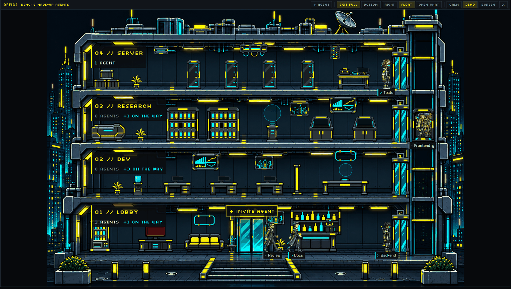

# PolyFlow City

A cyberpunk pixel-art layout for [Herdr](https://herdr.dev), plus **PolyFlow Office**: a mod that shows your
coding agents as characters walking around a four-floor office tower, with a chat view of each agent's conversation.



**Beta (v0.2.0-beta).** Built and tested on Windows 11. macOS and Linux are untested.

| Entry | Kind | What you get |
|---|---|---|
| [`polyflow-city/`](polyflow-city/) | layout | The whole look: night-city sidebar, character cards for agents, portrait tabs, neon theme, and the office |
| [`polyflow-office/`](polyflow-office/) | mod | Only the office tower, docked on the right of the layout you already use |

## Features

- **Agents as characters.** Every Claude Code or Codex agent gets a pixel character (netrunner, techie, solo,
  fixer, medtech and more) on its sidebar card and its tab. The character works, raises a hand when the agent
  needs you, and rests when it is done.
- **Spaces as buildings.** Each space in the sidebar is a small pixel building on a rainy skyline.
- **The office tower.** Agents walk to the station that matches what they are doing: desks for writing code,
  the archive for reading, the server room for running commands, the lobby help desk when they need you.
- **One chat, wherever you put it.** Open an agent's conversation from its character (the card's CHAT, or a
  plain click in the office's full mode): read the history, type a message, or switch to the real terminal. In the layout the same chat sits below the office (BOTTOM), beside it
  (RIGHT), in a floating window (FLOAT) or in the SCREEN window, always under a bar with CHAT and TERMINAL.
  Moving it keeps your draft, the tool calls you opened and the place you were reading.
- **DETAILS.** Next to the conversation: what the agent is doing now, the files it changed and read (with Git
  numbers and a read-only preview), its plan and its session. In a narrow chat this folds into a DETAILS drawer.
- **SHOW OLDER.** The chat loads the recent part of a conversation first; SHOW OLDER pages back through the rest,
  and through the previous conversation after `/clear`.
- **Subagents.** Claude Code's internal subagents (its Agent tool) appear under their agent in the sidebar tree,
  as people in the office, and in the chat. They are read only.
- **Context and limits.** A small battery over every character shows how much of its context window is free. A
  chip in the office bar and a LIMITS board in the lobby show the account's 5-hour and weekly usage for Claude
  Code and Codex.
- **Cost counter.** The chat's SESSION section shows how many reads and processes the mods run per minute.
- **Agent card.** Right-click a character for terminal, chat, message, stop, rename and close.
- **Calm mode** with no blinking lights (the SCREEN window follows it too), and a **demo mode** with a made-up
  crew.
- **Files, Changes and Inbox** pages in a side panel, carried over from Traveler.



## Install

Ask the agent in your Herdr window:

> Add the layout from https://github.com/nowilus/herdr-polyflow-city/tree/main/polyflow-city

or, for the office alone:

> Add the mod from https://github.com/nowilus/herdr-polyflow-city/tree/main/polyflow-office

By hand: copy the contents of `polyflow-city/` (the `layouts/`, `themes/` and `mods/` folders) into your Herdr
home (`~/.config/herdr-app`), then:

```sh
herdr-app check ~/.config/herdr-app/mods/polyflow-office
herdr-app do layout.switch --name polyflow-city
```

For the office alone, copy `polyflow-office/mods/polyflow-office` into `~/.config/herdr-app/mods/`. It docks on
the right of whatever layout you use. If it does not show up, add a block with `"content": { "mod": "polyflow-office" }`
(about 560px wide) to your layout, or ask your agent to.

The office runs its helper scripts with `node`, so `node` must be on PATH.

### Optional: activity hook

Without it the office still works: working agents sit at a desk. With it, the office knows which tool an agent is
using, the chat can show the conversation, and Claude Code's subagents appear. Hooks apply to sessions started
after you install them.

```sh
node ~/.config/herdr-app/mods/polyflow-office/hooks/install.mjs --dry-run   # show what would change
node ~/.config/herdr-app/mods/polyflow-office/hooks/install.mjs             # install
node ~/.config/herdr-app/mods/polyflow-office/hooks/install.mjs --uninstall # remove
```

### Optional: status line wrapper (Claude Code)

Claude Code hands its status line command the model, effort, context use and account limits. The wrapper keeps
those numbers for the batteries and the limits, then runs the status line you already had and prints exactly what
it prints. Without it, a Claude Code agent's battery shows `—` and there are no Claude limits. Codex needs no wrapper: with
the activity hook installed, the office reads the same numbers from the end of the Codex session file.

```sh
node ~/.config/herdr-app/mods/polyflow-office/hooks/install.mjs --statusline --dry-run   # show what would change
node ~/.config/herdr-app/mods/polyflow-office/hooks/install.mjs --statusline             # install
node ~/.config/herdr-app/mods/polyflow-office/hooks/install.mjs --remove-statusline      # put your old status line back
```

## What it runs and reads

Herdr asks agents to tell you this before installing a mod. In short:

- **No network.** None of the mods or their scripts make network calls.
- **Programs:**
  - `git`: the status of each space's folder; and, while the chat's DETAILS file lists are open, `rev-parse`,
    `status` and `diff HEAD --numstat` in the conversation's folder (once a minute, sooner after an edit).
  - `hc`: `send` and `interrupt` to type into an agent or stop it, `machine ls`; the hook's Codex fallback runs
    `ls` and `get`.
  - `node`, with the scripts in `mods/polyflow-office/hooks/`: the conversation reader (`transcript.mjs`) while a
    chat is open; `agent-meta.mjs` every 5 s while a local agent runs (model, effort, context and limits);
    `subagents.mjs` when a Claude Code session's subagent folder changes; `repo-files.mjs` (the `git` calls
    above); `file-preview.mjs` when you press OPEN on a file. Claude Code and Codex start `activity.mjs` (the
    optional hook), and Claude Code starts `statusline.mjs` (the optional wrapper), which runs your previous
    status line command through a shell.
  - On Windows `powershell.exe` and `rundll32.exe` for the inbox. The office's SCREEN button runs
    `screen/launch.cmd` (`launch.sh` elsewhere), which copies files (`robocopy` on Windows) and starts a second
    `herdr-app`.
- **Files read outside the mod folders:**
  - an agent's conversation file (`~/.claude/projects/…` or `~/.codex/sessions/…`) while its chat is open: the
    end of the file, then only what is added; older parts when you press SHOW OLDER; the end of the previous
    conversation after `/clear`;
  - the last 256 KB of each Codex session file every 5 s, for its model, context and limits;
  - Claude Code's subagent files next to a session (`subagents/agent-<id>.meta.json` and the end of
    `agent-<id>.jsonl`);
  - a file you open with OPEN in the chat's DETAILS (the first 256 KB, read only);
  - the files the hook and the wrapper write under `~/.config/herdr-app/data/polyflow-office/`, and the inbox
    folder `~/.config/herdr-app/data/inbox/files`.
- **Files written by the mods and their scripts**, all under `~/.config/herdr-app/data/` (the inbox creates its
  folder there):
  - `polyflow-office/metrics.json` (reads and processes per minute, for the cost counter) and
    `polyflow-office/prefs.json` (CALM, for the SCREEN window);
  - `polyflow-office/chat-cache/*.json`: where the reader stopped in each conversation (no message text; removed
    after 24 h);
  - `polyflow-office/meta/<terminal>.json` and `polyflow-office/limits/codex.json`: a Codex agent's model, effort,
    context and the account limits.
  - The SCREEN button writes a second Herdr home, `~/.config/herdr-app-office` (a copy of the mods, the theme, a
    layout and your `settings.json`).
- **Files written by the optional hook and wrapper:** the hook writes `polyflow-office/activity/` and
  `polyflow-office/sessions/` (tool names, file base names, the first words of commands or a URL's host, and the
  path of the session file; never prompts, file contents or tool output) and `polyflow-office/codex-sessions.json`
  (which Codex session runs in which terminal, when the terminal id is missing), and logs its own errors to
  `polyflow-office-hook.log` in the system temp folder. The wrapper writes `polyflow-office/meta/<terminal>.json`
  (model, effort, context) and `polyflow-office/limits/claude.json` (5-hour and weekly usage).
- **Your settings files** change only when you run the installer yourself. A plain install edits
  `~/.claude/settings.json` and `~/.codex/hooks.json`; `--statusline` sets `statusLine` in
  `~/.claude/settings.json` and keeps your previous command in `data/polyflow-office/statusline-chain.json`. Each
  file is first copied to a `.polyflow-backup-<time>` file. `--uninstall` and `--remove-statusline` undo them.
- **Actions on your agents:** the office can type into an agent (`hc send`), stop it, rename its tab and close
  it, but only when you click those buttons. Subagents cannot be written to, stopped or closed. It never answers
  approvals for you.

Each `RECIPE.md` lists the details.

## Updating

Copy the new folders over the old ones. Your character choices live in `mods/polyflow-agents/jobs.json`; keep
that file if you edited it. If you use the SCREEN window, close it and press SCREEN again: it copies the mods on
each launch. If you installed the activity hook with an older version, run `install.mjs` again, so Claude Code
also gets the `SessionStart` event.

## Credits

Forked from [Traveler](https://github.com/franky5440-afk/herdr-traveler) by Frank Lin (Apache-2.0), which
builds on Herdr's own spaces, tabs and chrome mods. Fonts: Chakra Petch and Silkscreen (SIL Open Font License).

## License

Code: Apache-2.0, see [`LICENSE`](LICENSE) and [`NOTICE`](NOTICE). Art: CC BY 4.0, "Art by nowilus (PolyFlow)",
see [`ART-NOTICE.md`](ART-NOTICE.md). The art is AI-generated.

This is a community project, not affiliated with Herdr.
