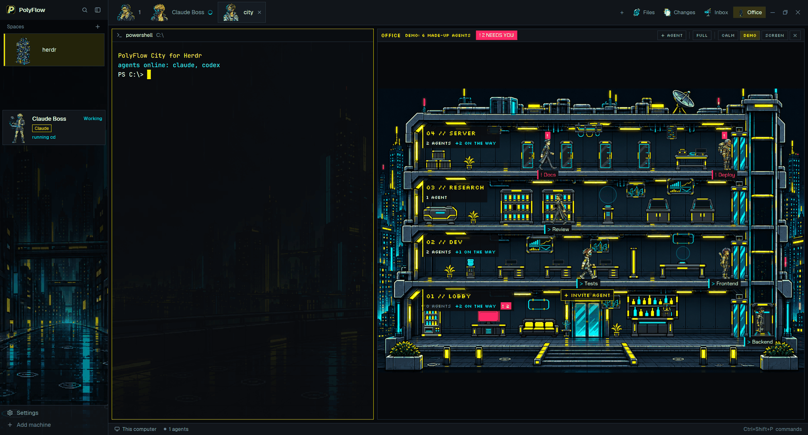

# PolyFlow City

A cyberpunk night-city layout for Herdr (beta). On the left is a dark sidebar painted like a rainy skyline: your spaces appear as little pixel-art buildings, and your running agents appear as cards with an animated pixel character each (a netrunner, a street samurai, a medic and so on) who works, raises a hand when the agent needs you, or rests when it is done or idle. Along the top runs a tab bar with a portrait on every tab and buttons for Files, Changes, Inbox and Office; your terminals sit on a dimmed neon skyline background with thin cyan borders. The Office button opens a cut-away office tower where every agent walks to the station that matches what it is doing, with a chat view of the agent's conversation below it, beside it, in a floating window or in a separate SCREEN window (a separate entry, `../polyflow-office/RECIPE.md`, describes the office and the chat in full). Palette: near-black blues, acid yellow `#fcee0a` for focus, cyan `#00e5ff` for "working".



Beta (v0.2.0-beta). Built and tested on Windows 11 only; macOS and Linux are untested (see Watch out).

## What you see

Window: one row, no OS title bar (`titlebar: none`; on Windows the tab bar carries minimize / maximize / close). Window background is the theme's `canvas` `#07090c`. Dividers are 1px `#2b3947`. Terminal text padding is 14px top/bottom, 12px left/right. Terminal background opacity is 0.6, so the skyline picture shows through.

Theme `polyflow-neon`. Key colors: background `#0b0d10`, foreground `#e8f0f7`, muted `#8a9cb0`, dim `#6e8296`, accent `#fcee0a` (selection tint `#fcee0a26`), working `#00e5ff`, blocked `#ff2a6d`, done `#57df9c`, idle `#4e6072`, unknown `#c86bff`, chrome and surface `#11151a`, popover and raised `#151b22`, border `#2b3947`, hover `#e8f0f714`.

Fonts: Chakra Petch for UI text in the office, Silkscreen (uppercase pixel font) for office signs and buttons. Both ship inside `mods/polyflow-chrome/fonts/`.

### Left: sidebar, 268px wide (the layout marks it not resizable; it folds to a 44px rail with the toggle button)

The sidebar has a background picture, `mods/polyflow-chrome/sidebar-v3.png`, scaled to cover. Top to bottom:

1. **Brand strip, 46px tall**, draggable window area. The octagonal "P" logo (`logo.png`, 22px), the word "PolyFlow" (semibold 13.5px), a search button (magnifier, 26px square) and a sidebar-toggle button. Background `#11151a` at about 78% opacity.
2. **Spaces list**, upper half of the remaining height (weight 1, min 90px). Header row 31px: "Spaces" in dim 11.5px and a "+" button. Each space is a card 76px high on `surface` at 95% opacity: a 72px pixel-art building on the left; the space's name (white, 13px, max 150px, truncated); on the right small dim git info only where unusual: repo name and/or branch (hidden when equal to the space name, and `main`/`master` are never shown), green `↑N` ahead, red `↓N` behind. Under the name up to three 11.5px lines: "N uncommitted files" (ansi yellow), "N unpushed commits" (ansi green), "N repos without a remote" (ansi red). The active space has a 3px acid-yellow bar on its left edge, a 1px border and a yellow 12% tint. A git worktree space is a 28px row under its main repo with a branch icon. When another machine is known, rows are grouped under a header per machine ("This computer" and each remote, with a connection dot).
   Buildings: six pictures (`tower`, `bar`, `datacenter`, `clinic`, `market`, `block`), chosen by name in `mods/polyflow-spaces/places.json` (shipped as `{}`), otherwise by a fixed hash (sum of the name's code points modulo 6).
3. **Agents list**, lower half (weight 1, min 90px), vertical scroll, 6px padding, 4px between cards. One card per agent, as a tree: a helper started with `hc run --parent`, and each of Claude Code's internal subagents (its Agent tool), sits indented 16px per level under its agent, with a 1px `#2b3947` guide line and elbow. Empty: "No agents" (dim, 12px).
   Card (padding 6x4, 8px gap, `surface` at 95% opacity, 1px `#2b3947` border; the focused agent gets a 12% acid-yellow tint and a 3px acid-yellow bar on its left edge): on the left the character's animated GIF, 54x72px (the GIFs are 144x192, a 36x48 pixel grid at 4x; nested cards 42x56). On the right, first row: the tab name (semibold, truncated; its tooltip reads like "Claude Opus 5.5 · effort high · 312k / 1M · 69% free"), a 56x14 context battery (see Context battery and limits) and the status word (11px). Below: optionally the session name (dim 11px); a program tag, a 10px framed label `Claude` (acid yellow) or `Codex` / `OpenCode` (violet `#c86bff`), followed by "model · effort" (dim 11px; for Codex/OpenCode on its own row) when the statusLine cache has them; and an activity line (11px, cyan; red when blocked) such as "reading main.rs", "editing app.ts", "testing npm run test", "thinking" or "needs you".
   A subagent's card is named `◇ <its description>` (at most 48 characters), has no program tag, shows "Working" or "Done", and goes away 60 s after the subagent finishes. A subagent of a subagent is shown at the same depth as the first one.
4. **Footer, 69px**, 1px top border. Two rows of 28px: "Settings" (gear icon; a 6px yellow dot appears when an app update is ready) and "Add machine" (dim, plus icon).

### Right: the work area, top to bottom

1. **Tab bar, 58px**, draggable, background `#11151a`, 1px bottom border. Tabs are 48px high, text 12.8px, name max 170px. Each tab starts with the tab's character portrait (44px; same character as its agent card; if the tab has no character, the program icon at 14px). Active tab: background `#151b22`, border `#2b3947`, white text, and a small close "x". Then a "+" button (26px), and four 26px-high buttons with a 20px picture: **Files**, **Changes**, **Inbox**, **Office** (an open panel's button is tinted `#fcee0a26`). On Windows the last three 26px buttons are minimize, maximize/restore and close.
2. **Body**, padded 8px with 8px gaps, left to right:
   - **Terminals** (node `main`): each pane has Herdr's 30px pane header (always shown), the dimmed skyline `map-v2.png` as background, a 1px `#00e5ff55` border, a 1px yellow focus border on the focused pane, square corners, 8px between panes.
   - **Office column** (node `office`), hidden at start; weight 1.5, min 320px, 1px border. Inside: the office itself, and the two docked chat places (right and bottom), hidden until the office's FULL mode shows one.
   - **Side panel** (node `panel`), hidden at start; 368px (min 280, max 900), a stack of three pages: Files, Changes, Inbox.
3. **Status bar, 28px**: Herdr's built-in `workspace-status`.

### The Inbox page

Header 38px: "Inbox" and "N file(s)". Each row is 52px: a 40px thumbnail for pictures (else a text badge "Image" / "Video" / "PDF"), the file name, and "size · yyyy-mm-dd hh:mm" in dim 11px. Empty: "The inbox is empty" plus the folder path.

## How it behaves

### Agent status

| Status | Agent card | Character |
|---|---|---|
| working | word "Working" in cyan; activity line in cyan ("reading x", "editing x", "thinking") | `<job>-working.gif` |
| blocked | word "Needs you" in `#ff2a6d`; card border `#ff2a6d` instead of grey; activity line "needs you" in red; focus bar red | `<job>-blocked.gif` (hand raised) |
| done | "Done" in `#57df9c` | `<job>-rest.gif` |
| idle / unknown | "Idle" in `#4e6072`, no activity line | `<job>-rest.gif` |

On a tab: working shows a cyan spinner, blocked and done show a 6px dot in `#ff2a6d` / `#57df9c`. In the Spaces list, agent state is not drawn; in the collapsed 44px rail a space shows its number and `●` (blocked or done) or `·`.

### Context battery and limits

Every agent card, and every person in the office, carries a small battery for the agent's context window. It shows the share that is still FREE: green `#57df9c` at 30% free or more, acid yellow from 10%, `#ff2a6d` below 10% (its outline then pulses, except in CALM), and `—` with a dim frame, at 40% opacity, when nothing is known. On the card it is 56x14 and shows only `NN%`; in the office it reads `CTX NN%`. The tooltip gives model, effort, tokens used of the window and the free share; a subagent's battery uses the size of its last request against its agent's window, and its line ends with "subagent".

Where the numbers come from: for Claude Code, the optional status line wrapper (`node ~/.config/herdr-app/mods/polyflow-office/hooks/install.mjs --statusline`), which writes `~/.config/herdr-app/data/polyflow-office/meta/<terminal>.json` and `limits/claude.json`; for Codex, `hooks/agent-meta.mjs`, run every 5 s, which reads the last 256 KB of the Codex session file (named by the activity hook's session record) and writes the same kind of files. The account limits (5-hour and weekly use, Claude Code and Codex) appear in the office: a chip in its bar and a LIMITS board in the lobby (see the office entry).

### Characters (jobs)

Eight characters: `corpo`, `fixer`, `medtech`, `netrunner`, `nomad`, `rockerboy`, `solo`, `techie`. A character belongs to a tab NAME (case-insensitive, trimmed), so tabs and agents with the same name share it. Assignment (`assignJobs` in `lib.js`), in order:

1. `mods/polyflow-agents/jobs.json` wins. Shipped: `Claude Code` -> netrunner, `Codex` -> techie, `Frontend` -> rockerboy, `Backend` -> solo, `Docs` -> corpo, `Tests` -> medtech, `Review` -> fixer, `Deploy` -> nomad.
2. Else the job remembered for the tab id (`"#<tab id>"`), so renaming a tab keeps its character.
3. Else the job remembered for the name.
4. Else the name starts at index (sum of its code points mod 8) and takes the next job not yet used; after all eight are used, jobs repeat.

The memory is the shared key `polyflow-city.jobs` (`rememberJobs`); the agents list is always mounted, so it writes it; tabs and office read it.

### Clicks, keys, hovers

- Agent card: hover makes the background opaque (`#151b22f8`); click points the office chat at that agent (shared `polyflow-office.chat-target`) and runs `agent.focus` on its terminal. A subagent has no terminal: a click focuses its agent's terminal and points the office chat at the subagent itself.
- Space card: click `space.select`; drag onto another space of the same machine `space.move` (source dimmed, 2px yellow insertion line); right-click opens the `menu` popup (tab "space"); header "+" `space.new`; a machine header folds its list (kept in `localStorage` `machines.folded`) and its "+" runs `space.new` for that machine.
- Tab: click `tab.select`; double-click `tab.rename`; right-click `menu` popup (tab "tab"); drag onto another tab `tab.move`; mouse wheel over the bar `tab.next` / `tab.prev`; "x" `tab.close`; "+" opens the `new-menu` popup (250px wide).
- Files / Changes / Inbox buttons: open the side panel on that page (`layout.select` stack `panel-body`, then `layout.show` node `panel`), or `layout.hide` it if that page is already showing. The open page is remembered per space (`localStorage` key `panels`): switching spaces restores that space's choice, closed if it never had one.
- Brand strip: search -> `mod.open` `picker`; toggle -> `layout.resize` of `sidebar` between 44px and its previous width (default 268).
- Footer: Settings `app.settings`; Add machine `mod.open` `machine-add`.
- Inbox row: click opens the file with the system default app (exact commands in Built from).
- Keys: none bound by default. The tabs mod accepts keys.json actions `polyflow-tabs.office-toggle`, `polyflow-tabs.office-full`, `polyflow-tabs.office-off` (add them yourself, e.g. in the `global` section).

### The Office button and its modes

The office column starts hidden and the terminals fill the area. The Office button toggles `off` <-> `side` (from `full` it goes to `off`). State lives in shared key `polyflow-office` as `{ mode: "off"|"side"|"full", chat: "bottom"|"right"|"float" }` (defaults `off`, `bottom`). Commands per mode (`mods/polyflow-office/modes.js`; `mods/polyflow-tabs/office-modes.js` is a byte-identical copy):

| Mode | Commands, in order |
|---|---|
| off | `layout.hide office-chat-right`, `layout.hide office-chat-bottom`, `layout.hide office`, `layout.show main` |
| side | hide both chat nodes, `layout.show main`, `layout.show office` (terminals and office side by side; the office keeps the width you dragged it to) |
| full | `layout.show office`, `layout.hide main`, then by `chat`: `right` shows `office-chat-right` (560px, min 320), `bottom` shows `office-chat-bottom` (340px, min 200), `float` shows neither (the floating chat window is used); for `right` and `bottom` also `layout.select` of stack `office-chat-<place>-body`, child `office-chat-<place>-chat` (the office picks `-terminal` instead while the chat is on its TERMINAL view) |

Each chat node is a column that cannot be resized: a 30px bar (the office mod with props `{ chatBar: "follow", chatPlace: "<place>" }`) over a stack `office-chat-<place>-body` with two children, `office-chat-<place>-chat` (the office mod's conversation view, props `{ chatPlace: "<place>" }`) and `office-chat-<place>-terminal` (`{ "agent": "focused" }`, the focused agent's real terminal). The bar's `TERMINAL` / `CHAT` button switches the stack with `layout.select`.

The office's own bar (30px) has `+ AGENT`, `FULL` / `EXIT FULL`, in full mode `BOTTOM` / `RIGHT` / `FLOAT` (and `OPEN CHAT` when float), `CALM`, `DEMO`, `SCREEN`, `X`. A red "! N NEEDS YOU" chip appears when any agent is blocked and lists them, and a limits chip such as `C 5H 35% · WK 21% | X 5H 12% · WK 40%` appears when the account usage is known. The floating chat is allowed in side (opened from an agent card's `CHAT`) and in full + float; in any other state the office closes it.

What the person sees in the office (details in `../polyflow-office/RECIPE.md`): a four-floor tower (SERVER 4, RESEARCH 3, DEV 2, LOBBY 1) with an elevator. Each agent is a small character, with its context battery over its head, on the floor and station matching what it does now: blocked -> lobby help console; done or idle -> lobby lounge; working -> by tool (reads at the archive, edits at a desk, web or MCP at comms, planning at the meeting table, shell at the test bench when the command looks like a test or build, else the server rack). Claude Code's subagents are people too, at the station of their own tool. Clicking a floor opens its 3/4 view; the LOBBY view has a LIMITS board that opens an account-usage window. In full mode a left click on a character only shows it in the chat and focuses it; a right click (anywhere), or a left click outside full mode, opens a small card (send a message, stop, rename, close, terminal or chat).

### The chat

One conversation view is open at a time, in the current place: in full + bottom or right the docked node, in full + float (or side, after a card's `CHAT`) the floating window, and in the SCREEN window its own docked chat. Its agent is the focused one (a click on a character, a card or a sidebar card focuses it), or a subagent of it picked the same way. Moving it between places keeps the draft, the tool groups you opened, whether it follows the newest message and the message you were reading. Each place has the same 30px bar: `CHAT` or `TERMINAL`, the tab name, the status, and a `TERMINAL` / `CHAT` switch (the floating window also has `−`, `+`, `□`/`▣`, `X`). Below 600px of width the side panel (NOW, CHANGED, READ, PLAN, SESSION) becomes a `DETAILS` drawer, so the right place (560px) always uses the drawer. A subagent's conversation is read only and has no terminal view. Everything else about the chat is in `../polyflow-office/RECIPE.md`.

### The SCREEN window

`SCREEN` opens the office in its own OS window (e.g. on a second monitor): a second Herdr with its own home, `~/.config/herdr-app-office`, switched to the layout `office-screen` (the office on top, a 320px docked chat below, built like the bottom node). It shows the same agents, reading their activity from the main home (named in `data/polyflow-office/source-home.txt`). Its bar has `OFFICE`, the count, the NEEDS YOU and limits chips, `CHAT` (shows or hides the docked chat, shared key `polyflow-office.screen-chat`) and `X` (closes the window). CALM follows the main window: the main office writes it to `data/polyflow-office/prefs.json` and the SCREEN window reads that file every 4 s; it has no CALM button of its own. Its chat drafts, sending and character memory are its own (another home, other shared state). The launcher copies the mods on every start, so after updating them close the SCREEN window and press `SCREEN` again.

### What moves

GIF characters animate; the tab spinner spins (900ms); office characters walk, ride the elevator and sit, and lights blink (CALM turns blinking and pulsing off, including a nearly empty battery's pulse, and makes the chat's elapsed times count in minutes). The activity line and the office refresh when the hook writes a file (folder watch) and at least every 10 s; batteries and limits every 5 s; subagents when their session folder changes (at most every 3 s, checked every 15 s while there are any, every 60 s otherwise); the statusLine cache is re-read on change and every 30 s; each space's git is re-checked after a command or an agent turn ends, and at most once a minute while the window is in front.

## Built from

### Layout `layouts/polyflow-city.json`

Forked from Herdr's `main` layout 0.1.11 (`cloned_from`). Root: `theme: "polyflow-neon"`, `background: "canvas"`, `titlebar: "none"`, `traffic_lights: [12, 16]`, `terminal_padding: [14, 12]`, `terminal_opacity: 0.6`, `divider: { width: 1, color: "border" }`. Node tree (sizes px):

```
root  row
  sidebar  column  size 268, min 44, max 480, resizable false, background image mods/polyflow-chrome/sidebar-v3.png (cover)
    brand           block  mod polyflow-chrome                              size 46, window_drag
    sidebar-lists   column
      spaces        block  mod polyflow-spaces                              weight 1, min 90
      agents        block  mod polyflow-agents                              weight 1, min 90
    sidebar-footer  block  mod polyflow-chrome, props { footer: true }      size 69
  work  column  resizable false
    tabs            block  mod polyflow-tabs                                size 58, window_drag
    work-body  row  padding 8, gap 8
      main          block  content { tab: "active", pane: {...} }
      office        column  hidden, weight 1.5, min 320, border { width 1, color "border" }
        office-top  row
          office-scene       block  mod polyflow-office
          office-chat-right  column  hidden, size 560, min 320, resizable false
            office-chat-right-bar        block  size 30, mod polyflow-office, props { chatBar: "follow", chatPlace: "right" }
            office-chat-right-body       stack  active "office-chat-right-chat"
              office-chat-right-chat     block  mod polyflow-office, props { chatPlace: "right" }
              office-chat-right-terminal block  content { agent: "focused" }
        office-chat-bottom   column  hidden, size 340, min 200, resizable false
          office-chat-bottom-bar         block  size 30, mod polyflow-office, props { chatBar: "follow", chatPlace: "bottom" }
          office-chat-bottom-body        stack  active "office-chat-bottom-chat"
            office-chat-bottom-chat      block  mod polyflow-office, props { chatPlace: "bottom" }
            office-chat-bottom-terminal  block  content { agent: "focused" }
      panel         column  hidden, size 368, min 280, max 900
        panel-body  stack  active "files"
          files     block  mod files                (shipped)
          changes   block  mod changes              (shipped)
          inbox     block  mod polyflow-inbox
    status          block  mod workspace-status (shipped)                   size 28
```

`main`'s `pane` options: `header { content: { mod: "pane" }, reveal: "always", height: 30, position: "top" }`, `background { image: "mods/polyflow-chrome/map-v2.png", fit: "cover" }`, `border { width: 1, color: "#00e5ff55" }`, `focus { width: 1, color: "accent" }`, `radius: 0`, `gap: 8`, `lone: true`. The mods find nodes by id (`sidebar`, `main`, `office`, `office-chat-right`, `office-chat-bottom`, their `-body` stacks and `-chat` / `-terminal` children, `panel`, `panel-body`); do not rename them.

The SCREEN window uses a second layout shipped inside the office mod, `mods/polyflow-office/screen/office-screen.json` (copied to the SCREEN home as `layouts/office-screen.json`): a column with `titlebar: "none"`, theme `polyflow-neon`, `terminal_padding: [8, 10]`; block `office-scene` (`window_drag`, mod `polyflow-office`, props `{ screen: true }`); then column `office-chat-bottom` (size 320, min 200, resizable false) with a 30px bar (props `{ chatBar: "follow", chatPlace: "screen" }`) and stack `office-chat-bottom-body` holding `office-chat-bottom-chat` (props `{ chatPlace: "screen" }`) and `office-chat-bottom-terminal` (`{ agent: "focused" }`).

### Theme `themes/polyflow-neon.json`

`background #0b0d10`, `foreground #e8f0f7`, `selection #1f3340`, `cursor #fcee0a`. ANSI 0-15: `#0b0d10 #ff2a6d #57df9c #fcee0a #3d8bff #c86bff #00e5ff #e8f0f7 #4e6072 #ff5c8a #7ff0b6 #fff35c #6aa8ff #d99bff #5cf0ff #ffffff`. `colors`: the UI colors above plus `solid #00e5ff`, `solid_foreground #0b0d10`, `accent_foreground #0b0d10`, `canvas #07090c`, `input #0d1116`. Mods read them via `theme()` (`t.accent`, `t.working`, `t.blocked`, `t.done`, `t.chrome`, `t.surface`, `t.raised`, `t.border`, `t.hover`, `t.solid_foreground`, `t.ansi1`...); keep those keys.

### Mods (in `mods/`; each `mod.json` has `"place": "none"`, used only from the layout)

Shipped Herdr mods used (not copied): `pane` (pane header, `mods/pane/close.svg`), `files`, `changes`, `workspace-status`, `menu`, `new-menu`, `picker`, `machine-add`, and icons from `mods/workspace-chrome/` (`plus`, `branch`, `server`, `monitor`, `chevron-*`, `spinner`). `polyflow-chrome`, `polyflow-spaces`, `polyflow-tabs` are re-tinted forks of Herdr 0.1.11's `workspace-chrome`, `spaces`, `tabs` (via Traveler). Each mod's `main.js` default-exports a class extending `View` (`gpui-kit`, `gpui-base`). The per-mod `jsconfig.json` and `gpui-kit.d.ts` are editor helpers only.

**polyflow-chrome** (`main.js`, 52 lines). No props: brand strip; `{ footer: true }`: footer. Calls `run("mod.open", { name: "picker" })`, `run("mod.open", { name: "machine-add" })`, `run("app.settings")`, `run("layout.resize", { id: "sidebar", px })`; reads `layout()`, `updates()`, `window()`, `shared("sidebar.width")`. Assets: `logo.png`, `sidebar-v3.png`, `map-v2.png`, svg icons, `fonts/ChakraPetch-Regular.ttf`, `ChakraPetch-SemiBold.ttf`, `Silkscreen-Regular.ttf`, `LICENSE-Silkscreen.txt`.

**polyflow-spaces** (`main.js`, `places.json`, `art/{tower,bar,datacenter,clinic,market,block}.png`). Calls `space.select`, `space.move`, `space.new`, overlay `menu`; reads `spaces()`, `panes()`, `machines()`; runs `git` via `exec` (see Watch out) and `hc(["machine","ls","--json"])` every 15 s; `watchFolder` on each local repo's git folder.

**polyflow-agents** (`main.js`, `lib.js`, `activity.js`, `activity-reader.js`, `chat-read-model.js`, `cost-meter.js`, `cost-model.js`, `energy.js`, `energy-pill.js`, `energy-pill-ui.js`, `folder-watch.js`, `meta-follow.js`, `meta-reader.js`, `subagents-follow.js`, `subagents-watch.js`, `ui-tokens.js`, `jobs.json`, `art/<job>.png`, `sprites/<job>-{working,blocked,rest}.gif`: 24 GIFs, 144x192). Every JS file except `main.js` is a byte-identical copy of the office mod's file of the same name. Reads `agents()`, `spaces()`, `terminals()`; calls `run("agent.focus", { terminal })` and `setAgentOrder` (subagents included); sets shared `polyflow-city.jobs` and `polyflow-office.chat-target`; reads `polyflow-office.calm`. It shares two readers with the office through leases in shared state: the energy reader (`polyflow-office.meta`, which also holds the limits) and the subagent reader (`polyflow-office.subagents`, lease `polyflow-office.subagents-reader.v1`). The office takes either lease at once; the tree takes one only after 15 s without the office's heartbeat, so with the office closed the tree keeps batteries and subagents going on its own. Both readers run scripts of the office mod: `node ~/.config/herdr-app/mods/polyflow-office/hooks/agent-meta.mjs <home> <terminal ids>` every 5 s and `node .../hooks/subagents.mjs <session file>` when a Claude Code session's subagent folder changes; without the office mod installed the tree has no batteries and no subagents. It counts its own reads into `data/polyflow-office/metrics.json` (writer role `tree`). Local files it reads (via Herdr's `readTextFile` / `watchFolder`):
 1. `~/.config/herdr-app/data/polyflow-city/sessions/<terminal id>.json`, an optional statusLine cache `{ updatedAt, model, effort, sessionName, contextRemainingPct, fiveHourRemainingPct }`. Only model, effort and session name are drawn. Nothing in this build writes it (the shipped status line wrapper writes `data/polyflow-office/meta/` instead, which feeds the battery and its tooltip), so the "model · effort" and session-name lines stay empty unless you supply that cache.
 2. `~/.config/herdr-app/data/polyflow-office/activity/<terminal id>.json`, written by the optional office hook; gives the activity line. Without it cards say "thinking" and, when blocked, "needs you".
 3. `~/.config/herdr-app/data/polyflow-office/sessions/<terminal id>.json` (the hook's session record: where a Claude Code agent's subagents live) and `data/polyflow-office/source-home.txt` (present only in the SCREEN window's home).
 4. For an agent on a remote machine, the statusLine cache path in that machine's Herdr folder, read with `readTextFile(path, { on: machine })` over Herdr's own connection.

`activity.js` (byte-identical copy in the office mod) maps tool names to stations: ask-user -> help console; read/glob/grep/ls -> archive; edit/write/apply_patch -> desk; web fetch/search and `mcp__*` -> comms; task/todo/plan -> meeting table; shell -> test bench for test/build-looking commands, else server rack; any other tool -> desk; a record older than 120 s counts as stale. It also builds the tree (`agentTree`, `parentsOf`), adds helpers without a pane (`withHelpers`) and Claude Code subagents (`withSubagents`, addresses `<agent>~<id>`, marked `internal`).

**polyflow-tabs** (`main.js`, `lib.js` with the same job logic, `office-modes.js`, `art/{files,changes,inbox,office}.png`, `win-{min,max,restore,close}.svg`). Calls `tab.select/move/rename/close/next/prev`, `window.minimize/maximize/close`, `layout.select/show/hide`, the office-mode commands (in full + bottom/right it always selects the `-chat` child); overlays `menu` and `new-menu`; reads `jobs.json`. Panel buttons: shared key `workspace.panels` (default `["files","changes"]`) plus always `inbox`. A code comment mentions `office-40/60/70` commands; they do not exist.

**polyflow-inbox** (`main.js`, `lib.js`). Lists `~/.config/herdr-app/data/inbox/files` (created on first load): top-level regular files only, extensions `png jpg jpeg webp gif mp4 mov pdf`, no hidden files, no links, newest first, at most 200 rows; thumbnails for images up to 20 MB. It runs, always with argument arrays through `exec` (never a shell string):
 - Windows: `powershell.exe -NoProfile -NonInteractive -Command ...` using `Get-ChildItem -LiteralPath <dir> -File -Force` (list) and `Get-Item -LiteralPath <file>` (check it is a regular file, not a reparse point); to open, `rundll32.exe url.dll,FileProtocolHandler <file>`. The folder is created with Node `fs/promises` `mkdir`.
 - Other platforms (code path written for macOS): `/bin/mkdir -p`, `/usr/bin/find ... -exec /usr/bin/stat -f "%m %z %N"`, `/usr/bin/stat -f %HT`, `/usr/bin/open`. These are BSD flags and will not work on Linux.
 It never writes, deletes or sends anything.

**polyflow-office** (large: 56 JS files, 14 scripts in `hooks/`, `art/`, `screen/`). Wired into this layout by node `office-scene` (`mod: "polyflow-office"`), the Office button of `polyflow-tabs`, node `office`, and the chat nodes `office-chat-right` and `office-chat-bottom` with their bars and stacks; mode logic `mods/polyflow-office/modes.js`, state key `polyflow-office`. The same mod also draws the chat places and overlays, chosen by props: `chatBar`, `chatPlace`, `deskChat` (the floating window's conversation), `agentCard`, `newAgent`, `filePreview`, `limitsWindow`, and `screen` (the SCREEN window's office). Without a node `office` in the layout it runs "standalone" (always on, floating chat only). Everything else, including art and tests, is in `../polyflow-office/RECIPE.md`. Calls that matter here: `layout.show/hide/select`, `agent.focus`, `tab.new` (the `+ AGENT` dialog; programs from `knownAgents()` of the chosen space's machine), `tab.rename`, `tab.close`, `terminal.kill`, `window.close`, `hc send <terminal> <text>`, `hc interrupt <terminal>`, `exec("node", [.../hooks/<script>.mjs, ...])` for `transcript.mjs`, `agent-meta.mjs`, `subagents.mjs`, `repo-files.mjs` and `file-preview.mjs`, `writeTextFile` for `data/polyflow-office/metrics.json` and `prefs.json`, and for SCREEN `exec("cmd", ["/c", launch.cmd, ...])` on Windows or `exec("sh", [launch.sh, ...])`.

### Art

Pixel art, AI-generated (OpenAI Codex image generation), then keyed on `#ff00ff`, scaled nearest-neighbour and assembled into GIFs with ImageMagick. A fresh build needs, under `~/.config/herdr-app/`:
 - `mods/polyflow-chrome/`: `logo.png` (octagonal "P"), `sidebar-v3.png` (tall dark rainy skyline, dim enough for cards to stay readable), `map-v2.png` (wide dark skyline, about 85% darkened), svg icons.
 - `mods/polyflow-spaces/art/`: six building PNGs (shown at 72px).
 - `mods/polyflow-agents/art/`: eight portraits `<job>.png`; `mods/polyflow-agents/sprites/`: per job `-working`, `-blocked`, `-rest` GIFs, 144x192 (a 36x48 pixel grid at 4x).
 - `mods/polyflow-tabs/art/`: `files.png`, `changes.png`, `inbox.png`, `office.png` (shown at 20px).
 - the office art (see the office entry).

The context battery is drawn in code, not from a picture.

Characters: netrunner (spiky blond hair, cyan visor, black jacket with yellow trim), techie (dreadlocks, goggles, mechanical arm), solo (cyan eye implant, long coat, katana), fixer (yellow sunglasses, charcoal coat), medtech (white-grey jacket with lime cross), nomad (grey buzz-cut, backpack, scarf), rockerboy (violet mohawk, guitar), corpo (slick hair, dark suit, thin yellow tie). No text or real brand logos inside pictures. If a picture is missing the mods fall back (program icon on tabs, blank on cards).

### Licenses and lineage

Code: Apache-2.0 (`LICENSE`). `NOTICE`: fork of the Traveler layout (`https://github.com/franky5440-afk/herdr-traveler`, Apache-2.0, (c) 2026 Frank Lin); Traveler's `traveler-chrome/spaces/agents/tabs` and `inbox` became `polyflow-chrome/spaces/agents/tabs/inbox` (renamed, retinted, cyberpunk characters and buildings, opaque card hovers, Windows branch for the inbox); Traveler's spaces/tabs/chrome derive from Herdr 0.1.11's built-in mods (Apache-2.0). Art: Creative Commons Attribution 4.0, "Art by nowilus (PolyFlow)", not covered by Apache-2.0; AI-generated, and the rights in AI-generated images are not settled in every jurisdiction. "PolyFlow" and the "P" logo are marks: the license does not allow branding another product with them. Keep `LICENSE`, `NOTICE`, `ART-NOTICE.md` with the layout. Fonts Chakra Petch and Silkscreen: SIL Open Font License.

## Watch out

- **Beta, Windows only.** Run only on Windows 11. macOS and Linux are untested. Known gaps: the inbox's non-Windows branch uses BSD `stat -f` and `/usr/bin/open` (fails on Linux with "Cannot read the inbox"); SCREEN's `launch.sh` was not tried.
- **No network access.** A search of all mods' `.js`, `.mjs`, `.cmd` and `.sh` files for `fetch(`, `XMLHttp`, `curl`, `wget`, WebSocket and net/http modules finds no network call (the only hit is the word "curly" in a comment of the inbox). The only remote contact is Herdr's own connection to machines you added yourself (`hc machine ls`, `git` and file reads with `on: <machine>`). The optional status line wrapper runs the status line command you had before, which is yours.
- **Programs it runs** (argument arrays): `git` in each space's folder, local or remote (`status --porcelain=v2 --branch`, `rev-parse --show-toplevel`, `rev-parse --git-common-dir`, with `--no-optional-locks` and `core.fsmonitor=false`), and, through `hooks/repo-files.mjs`, in the repository of the conversation shown in the chat (`rev-parse --show-toplevel`, `status --porcelain=v1 -z --no-renames --untracked-files=all`, `rev-parse --verify --quiet HEAD`, `diff HEAD --numstat -z --no-renames --no-ext-diff --no-textconv`; only while the chat's CHANGED or READ list is open, once a minute and soon after an edit); `hc` (`machine ls --json`, `send`, `interrupt`, and `ls` / `get` inside the hook's Codex fallback); `powershell.exe` and `rundll32.exe` (inbox); `node` with the office's scripts (`transcript.mjs`, `agent-meta.mjs`, `subagents.mjs`, `repo-files.mjs`, `file-preview.mjs`, and the optional `activity.mjs` and `statusline.mjs`, which Claude Code and Codex start); `cmd /c launch.cmd` (SCREEN; `robocopy` inside).
- **Inbox opens files.** A click hands the file to the OS default app. Only the listed extensions in the top level of `~/.config/herdr-app/data/inbox/files` can be opened.
- **The statusLine cache has no generator.** `data/polyflow-city/sessions/*.json` is read if present; nothing in this build writes it. Without it only the model/effort and session-name lines of the agent cards are missing; the battery comes from `data/polyflow-office/meta/` instead.
- **The activity hook is optional and installed by hand.** `node ~/.config/herdr-app/mods/polyflow-office/hooks/install.mjs` adds a hook (PreToolUse, PostToolUse, UserPromptSubmit, Stop, and for Claude Code also SessionStart; 5 s timeout) to `~/.claude/settings.json` and `~/.codex/hooks.json`. Before each change the file is copied to `<file>.polyflow-backup-<timestamp>`. `--dry-run` writes nothing. `--uninstall` removes only entries whose command contains `polyflow-office/hooks/activity.mjs`; other hooks are kept. The hook (`hooks/activity.mjs`) stores only the tool name, a file's base name, a command's first words or a URL host, plus the session's transcript path (and, after `/clear`, the previous one); never prompts, file contents or tool output. Calls made inside a Claude Code subagent (the hook input carries `agent_id`) are ignored. It writes `data/polyflow-office/activity/<terminal>.json` and `sessions/<terminal>.json` only for a Herdr terminal. When the terminal id is missing (an older Codex, or an agent started outside Herdr) it tries to match the session to a live Codex terminal by folder and start time (`hooks/codex-terminal.mjs`, which runs `hc ls` and `hc get` and records the result, a miss included, in `data/polyflow-office/codex-sessions.json`); such a match is marked `bound: "guess"` and the chat then refuses to write to it. Hook errors go to `<tmp>/polyflow-office-hook.log`. Without the hook everything still works: working agents show "thinking" and sit at a desk, there is no conversation in the chat, and no subagents appear.
- **The status line wrapper is optional too.** `install.mjs --statusline` sets `statusLine.command` in `~/.claude/settings.json` to `hooks/statusline.mjs` (backup first) and keeps your previous command in `data/polyflow-office/statusline-chain.json`; the wrapper runs that command through a shell with the same input (killed after 1.5 s) and prints only its output. `--remove-statusline` puts your command back. It stores only the model, effort, context numbers and the 5-hour and weekly usage.
- **Conversation files are read** when a chat is open for an agent: `~/.claude/projects/...jsonl` or `~/.codex/sessions/...jsonl`, path taken from the hook's session record. The office runs `node ~/.config/herdr-app/mods/polyflow-office/hooks/transcript.mjs --v3 ...`, which reads the last 12 MB (48 MB if that holds no message), then only what was appended, and writes where it stopped to `data/polyflow-office/chat-cache/<16 hex>.json` (no message text). SHOW OLDER reads older parts on demand. Codex session files are also read every 5 s (the last 256 KB) for the battery and limits, and Claude Code's subagent files next to a session for the subagents. Needs `node` on PATH. Nothing is sent anywhere. The reader accepts any path ending in `.jsonl`; it trusts the session record.
- **The office can type into your agents.** `hc send` writes text into an agent's terminal (chat box, card message; refused while the agent is blocked on an approval) and `hc interrupt` sends the stop key. The card can rename the tab and close the agent (`tab.close`, or only `terminal.kill` when the tab holds anything else). Approvals and questions must be answered in the real terminal. Subagents are read only: nothing can be sent to them, stopped, renamed or closed.
- **The mods write two files themselves.** `data/polyflow-office/metrics.json` (reads and processes per minute of the office, the tree and the chat, for the chat's SESSION section) and `data/polyflow-office/prefs.json` (CALM, for the SCREEN window).
- **SCREEN writes a second Herdr home.** It copies the `polyflow-*` mods (`robocopy /MIR`, without `gpui-kit.d.ts` and `jsconfig.json`, so edits there are overwritten on each launch), the theme, the `office-screen` layout and your `settings.json` into `~/.config/herdr-app-office`, writes `data/polyflow-office/source-home.txt`, starts a second `herdr-app` with `HERDR_APP_HOME` pointing there, and tries `layout.switch` for up to 20 s. Needs `herdr-app` on PATH. Drafts and the character memory there are separate from the main window, so a renamed tab may show a different character in SCREEN.
- **Characters are per tab NAME**, not per agent: same name, same character; only eight exist, the ninth distinct name repeats one. A renamed tab keeps its character only after the memory has seen its id.
- **Controls that do nothing or little.** No keys are bound by default. The HP/SP bars of the original are not drawn. `places.json` is `{}`. The `space.colors` shared key is still computed but not drawn. Sidebar drag-resize is disabled by the layout, and so is resizing the chat nodes.
- **Sizes.** Sidebar 268px (rail 44px), panel 368px (280-900), office weight 1.5 (min 320), chat nodes 560 / 340px (the SCREEN chat 320px); the chat's side panel turns into a DETAILS drawer below 600px; the agents tree shows nested cards at most two sizes (54x72, then 42x56).
- **Folder names matter.** Mods read their own files by path from the Herdr home (`mods/polyflow-agents/jobs.json`, `mods/polyflow-office/art/...`, `mods/polyflow-office/hooks/...`). Use exactly `mods/polyflow-chrome`, `polyflow-spaces`, `polyflow-agents`, `polyflow-tabs`, `polyflow-inbox`, `polyflow-office`, `themes/polyflow-neon.json`, `layouts/polyflow-city.json`. Keep `office-modes.js` (tabs) identical to `modes.js` (office), `lib.js` identical in agents, tabs and office, and these files identical between agents and office: `activity.js`, `activity-reader.js`, `chat-read-model.js`, `cost-meter.js`, `cost-model.js`, `energy.js`, `energy-pill.js`, `energy-pill-ui.js`, `folder-watch.js`, `meta-follow.js`, `meta-reader.js`, `subagents-follow.js`, `subagents-watch.js`, `ui-tokens.js`.
- **Image cache.** Herdr caches images by file name; a redrawn picture needs a new name.
- **Fonts.** Without Silkscreen or Chakra Petch the office falls back to a default font and its signs lose the pixel look.

## Done when

1. `herdr-app check` passes for each of the six mods and `layout.switch` to `polyflow-city` applies theme `polyflow-neon` with no error toast.
2. No OS title bar; a 268px sidebar on the left shows the skyline picture, the "P" logo with "PolyFlow", a search and a toggle button; a 58px tab bar on top; a 28px status bar at the bottom.
3. Each space is a card with a 72px building; the active one has a yellow left bar; clicking another space switches to it.
4. Start Claude Code or Codex in a tab: an agent card appears with an animated character, tab name, a context battery, program tag and status word. While working the word is "Working" in cyan with the working GIF; when it asks for approval the border and word turn `#ff2a6d` ("Needs you") with the hand-raised GIF; when finished it shows "Done" in green with the resting GIF. Clicking the card focuses that terminal.
5. Tabs named `Claude Code` and `Codex` get a netrunner and a techie; two other differently named tabs get two different remaining characters; renaming one keeps its character. The tab portrait (44px) matches the card's character.
6. Files, Changes and Inbox each open the 368px side panel on their page; clicking the same button again hides it; switching spaces restores each space's last choice.
7. A `.png` and a `.pdf` put in `~/.config/herdr-app/data/inbox/files` both appear in Inbox within a second, newest first, the png with a thumbnail and the pdf with a "PDF" badge; a `.txt` does not appear; clicking a row opens it in the default app.
8. The Office button opens the office column beside the terminals; `FULL` hides the terminals and shows the chat (`BOTTOM` 340px and `RIGHT` 560px as docked nodes with a 30px bar, `FLOAT` a window); the bar's `TERMINAL` shows the agent's real terminal in the same place and `CHAT` brings the conversation back; switching `BOTTOM` / `RIGHT` / `FLOAT` keeps a typed draft; `X` returns to terminals only; shared state `polyflow-office` matches. `DEMO` shows "DEMO: N MADE-UP AGENTS".
9. A blocked agent shows a red "! 1 NEEDS YOU" chip in the office bar and stands at the lobby help console. With the hook installed, a working agent that reads a file stands at the archive on floor 3; without it, working agents stand at a desk on floor 2.
10. After `node ~/.config/herdr-app/mods/polyflow-office/hooks/install.mjs`, `~/.claude/settings.json` has five events (PreToolUse, PostToolUse, UserPromptSubmit, Stop, SessionStart) with a `polyflow-office/hooks/activity.mjs` command, `~/.codex/hooks.json` has the first four, and `.polyflow-backup-*` copies exist; `--uninstall` removes exactly those entries.
11. With the hook installed, a Claude Code agent that starts a subagent (Agent tool) gets an indented `◇ <description>` card under it in the sidebar and a person in the office; clicking the card focuses the agent's terminal and the office chat shows the subagent's conversation, read only.
12. `SCREEN` opens a second window with the office and a docked chat; pressing `CALM` in the main window turns the SCREEN window calm within about 5 s.
13. A search of the six mod folders for `fetch(`, `http://`, `https://`, `curl` finds no network call.
