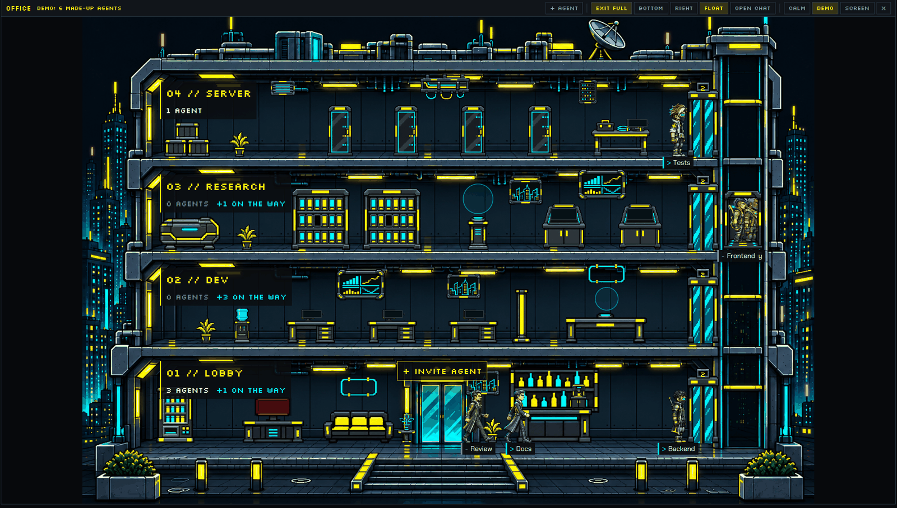

# PolyFlow Office

A four-storey cyberpunk office tower that sits in a 560 px column on the right of your Herdr window. Every
coding agent you run is a small pixel person who walks to the station that matches the tool it is using right
now: reading goes to the archive, editing to a desk, running a build to the server room, asking you a question
to the lobby help desk. A glass elevator carries people between floors, and a small battery over each head shows
how much of the agent's context window is still free. Click a person for a card (terminal, chat, message, stop,
rename, close), click a floor to walk around it in a 3/4 picture, or open a floating chat window that shows the
agent's actual conversation, with what it is doing, the files it touched, its plan and its session beside it.

Status: beta (v0.2.0-beta), built and tested on Windows 11 only; macOS and Linux are untested. The published
`mod.json` is `{"place":"right","size":560,"title":"Office"}`.

## What you see

The mod runs on its own in whatever layout you have (this is the main case, called "standalone" below). Inside
the PolyFlow City layout it gains extra modes and chat places; see `../polyflow-city/RECIPE.md`.

Shared look: buttons are 24 px high with 8 px side padding, Silkscreen 10 px, a 1 px `border` frame, background
`surface` at 90% opacity and `muted` text; on hover the text turns `foreground` and the frame `accent`; a pressed
toggle gets `accent` text and an `accent` background tint at 15%; a primary button is filled `accent` with dark
text `#0b0d10`. Body text is Chakra Petch 12 px, small text 11 px, fields 13 px, titles 14 px; labels and badges
Silkscreen 9 px.

### The panel, top to bottom

1. **Bar**, 30 px high, background `chrome` theme color, 1 px bottom border `border`, 8 px side padding, 4 px
   gaps. Left to right:
   - `OFFICE` in Silkscreen 12 px, `accent` color.
   - A count in Silkscreen 10 px, `dim`: `N AGENTS`; in demo mode it is `DEMO: N MADE-UP AGENTS` in `accent`.
   - Only when at least one agent is blocked: a chip `! N NEEDS YOU`, `blocked` background, dark Chakra Petch
     12 px text, 24 px high. Tooltip "Agents waiting for you: click for the list".
   - Only while a new agent is starting: `CONNECTING <NAME>...` in Silkscreen 10 px, `working` color.
   - Only when account usage is known: the limits chip, for example `C 5H 35% · WK 21% | X 5H 12% · WK 40%`
     (C is Claude Code, X is Codex; 5H the 5-hour window, WK the week). Chakra Petch 11 px, 22 px high, at most
     300 px wide, 1 px frame and text in `working`, `accent` from 70% used, `blocked` from 90%. Its tooltip has one
     line per window, such as `CLAUDE 5H · 35% used · resets in 2 h 14 min · as of 14:05 · 3 min ago`.
   - A flexible gap, then the buttons `+ AGENT`, a 1 px divider, `OPEN CHAT`, a divider, `CALM`, `DEMO`.
2. **Scene**, everything below the bar, background `canvas`. It shows either the tower or one open floor.
   A short notice line (Silkscreen 10 px, `accent`, bottom left, 10 px from the left and 8 px from the bottom)
   appears for messages such as `OPENING SCREEN...`, the new-agent notices or a `CALM sync: ...` error.

### The tower

A 1536 x 1024 picture scaled to fit (contain, centred, letterboxed on `canvas`). At 560 px wide the scale is
about 0.36, so the figures are small; the 12 px name tags do not scale and stay readable.

Four floors, top to bottom (floor line y in picture px in brackets), plus a glass elevator shaft on the right:

| Floor | Name | What is in it |
|---|---|---|
| 04 (y 294) | SERVER | four server racks (x 540, 680, 820, 960) with a swinging door and LEDs; a test bench (x 1130) with two stand spots; crates, plant, vent, cable tray, status panel |
| 03 (y 490) | RESEARCH | two archive shelves with drawers (x 500, 650); a holo pedestal (x 830); two comms consoles (x 1010, 1170); capsule, poster, wall screen, plant |
| 02 (y 686) | DEV | three desks (x 480, 650, 820) with screens; a meeting table (x 1100) with two talk spots; wall screen, poster, water cooler, floor lamp, neon frame, plant |
| 01 (y 896) | LOBBY | help desk with an alarm light (x 400); sofa with two seats (x 580); bar counter with coffee machine and two talk spots (x 990); back bar, vending machine, side table, neon, poster, plant; the street door at x 750 |

Each floor carries a sign plate at its top-left (22 px in, 18 px down, picture px): `0N // LABEL`
(Silkscreen, `accent`), then `N AGENT(S)`, then `+N ON THE WAY` (`working`) when people are riding or walking
toward it, a pulsing `blocked`-colored `! N` chip for blocked agents, and `DONE N` in `done` color. The LOBBY
also has a `+ INVITE AGENT` plate above the street door.

The elevator: a cabin 84 x 126 picture px in the shaft at x 1386, two glass door leaves on every floor at
x 1302, and a floor-number display above each doorway (the digit is `working` color at rest and `accent`,
blinking, while the cabin moves). Capacity 2 riders.

### The people

Every agent is one figure with a name tag under it: a plate with a 3 px left edge in the status color, a
status symbol, then the tab name. Tag text is Chakra Petch 12 px. Status shows three ways at once (color,
symbol, and the word in the tooltip):

| Status (Herdr) | Tag color | Symbol | Word |
|---|---|---|---|
| working | `working` | `>` | WORKING |
| blocked | `blocked` | `!` | NEEDS YOU |
| done | `done` | `+` | DONE |
| idle | `dim` | `-` | IDLE |

Eight characters (jobs): corpo, fixer, medtech, netrunner, nomad, rockerboy, solo, techie. A character is
picked from the tab name (sum of its letters as a starting point, skipping characters already taken; after all
eight are taken they repeat). Tower figures are 84 x 112 picture px side-view GIFs.

Claude Code's internal subagents (its Agent tool) are people too, named `◇ <its description>` (at most 48
characters). They need the activity hook (see Where people stand).

At most 3 people are drawn per floor; if a floor holds more, a `+N` plate (Silkscreen, 1 px `border` frame)
appears on that floor and lists everyone.

### The context battery

Over every person's head, in the last layer (above furniture and tags), a battery drawn in code shows the share of
the agent's context window that is still FREE: `CTX` on the left, `NN%` on the right, a fill bar and a 3 px nub.
72 x 20 px in the tower, 96 x 28 px on an open floor (the sidebar of the City layout uses a 56 x 14 version with
only `NN%`). Colors: fill `#57df9c` at 30% free or more, `accent` from 10%, `blocked` below 10% (the outline then
pulses, except in calm mode); when nothing is known, `—` with a `dim` frame, the whole battery at 40% opacity. Frame `#0b151c` with a `#394856`
border, track `#283744` with a `#6e8296` border, text `#e8f0f7`, corner radius 5. Batteries that would overlap move
up by their height plus 2 px. Tooltip (also on the name tag): `Claude Opus 5.5 · effort high · 312k / 1M · 69%
free` (screen readers get it with `Context: ` in front); unknown parts are left out, nothing known reads "no data
yet". A subagent's battery is the size of its
last request against its agent's window, and its line ends with "subagent".

The numbers come from the agent itself: Claude Code reports them to its status line command, which the optional
wrapper keeps (see The hooks); for Codex the office reads them from the end of its session file. Without the
wrapper a Claude Code agent's battery reads `—`.

## How it behaves

### Where people stand (the whole idea)

The activity hook records the tool the agent is using. The tool name picks a station; the station picks the floor:

| Agent state | Station | Floor | What it looks like |
|---|---|---|---|
| blocked | help desk | LOBBY | sit-type; pulsing `!` bubble; the help desk alarm lights up |
| done, idle, or no status | lounge: sofa (two seats) or bar | LOBBY | sit-relax on the sofa |
| working, tool Read, Glob, Grep, ls, NotebookRead, view_image, read_file, list_dir, find, search_files | archive shelf | RESEARCH | use; a data disk in hand; the drawer opens |
| working, tool WebFetch, WebSearch, web_search, web_fetch, fetch, or any `mcp__*` tool | comms console | RESEARCH | use; screen lights |
| working, tool Edit, Write, MultiEdit, NotebookEdit, apply_patch, write_file, create_file | desk | DEV | sit-type; screen lights |
| working, tool Task, Agent, TodoWrite, update_plan, ExitPlanMode, EnterPlanMode, spawn_agent | meeting table | DEV | talk, with a `...` bubble |
| working, tool Bash, shell, exec_command, local_shell, powershell, unified_exec | rack | SERVER | use; the rack door opens |
| same shell tools, when the command head contains test, tests, pytest, jest, vitest, cargo, go, build, make, cmake, gradle, mvn, tsc, lint, check, npm, pnpm, yarn, bun or dotnet | test bench | SERVER | use |
| AskUserQuestion, request_user_input | help desk | LOBBY | as blocked |
| working with no fresh record (older than 120 s, or no hook installed) | desk | DEV | sit-type; the tooltip says "thinking" |
| working, any other tool | desk | DEV | sit-type; the tooltip says "editing <target>" or "editing (<tool>)" |

Status wins over the tool: a blocked agent is always at the help desk, done/idle always in the lounge.
A subagent follows the same rules with its own status (working or done) and the call it is in now, read from its
own conversation file; a finished one rests in the lounge for 60 s and then leaves, and one silent for more than
2 hours is dropped.
Two or more resting agents in the lobby: the first two meet at the bar and talk; after 2.6 s there each holds a
cup. A spot is never shared; if a station has no free spot the person stands idle at x 200, 270, 340 ... on that
floor. When a floor has more than 3 people, the drawn ones are: blocked first, then the focused agent, then
working ones, then by address.

### Movement

- People walk at 0.12 picture px per ms, facing the way they go.
- To change floor a person walks to the elevator, waits in line facing the doors (places 34 px apart), the
  cabin comes (doors take 450 ms, stay open at least 700 ms, 900 ms per storey), up to 2 board, ride inside
  behind the glass, and walk out at the target floor. Door leaves slide apart only while the cabin stands there.
- The first time the office is drawn everyone is simply placed at their station. An agent that appears later
  walks in from the street door in the lobby (x 750), then to its station.
- The tower is not updated while a floor is open (it starts fresh when you return).
- The view redraws only when something visible changes (a new leg, a status, a name, a door, a cup); the tick is
  250 ms, and positions glide with transitions on `left` and `top` between ticks. Batteries glide with their people.

### Clicks and hovers (standalone)

| Action | Result |
|---|---|
| Hover a floor | 2 px `accent` frame, faint yellow tint `#fcee0a10`, a chip `OPEN FLOOR >` (accent background, dark text) at the bottom right |
| Click a floor (not a person or plate) | Opens that floor's picture view (below) |
| Hover a person | Tooltip `<name> - <WORD>[: what it is doing] · <context line>`, for example `docs - WORKING: editing App.tsx · Claude Opus 5.5 · effort high · 312k / 1M · 69% free`; the middle part reads like `testing npm run test`, `reading main.rs`, `searching example.com`, `planning (TodoWrite)`, `thinking`, `needs you: answer in its terminal`, `finished its turn`, `resting` |
| Left click a person or its tag | The agent is focused (`agent.focus`; a subagent focuses its agent's terminal) and becomes the chat's agent (an open chat switches to it), then its card opens at the pointer |
| Right click a person or its tag | Only the card opens, nothing is focused |
| Click `+N` | A 320 px list of everyone on that floor, blocked first, then working, with `OPEN FLOOR` and `X`. Rows: left click focuses and opens the card, right click only opens the card |
| Click `! N NEEDS YOU` | A 320 px list (`blocked` frame) of the blocked agents; same row clicks |
| Click `+ INVITE AGENT` or the bar's `+ AGENT` | The new-agent dialog |
| `OPEN CHAT` | Opens the floating chat on the chat's agent: the focused agent (or a subagent of it you picked), else the first agent |
| Hover the limits chip | Its tooltip (one line per window); it has no click |
| `CALM` | Calm mode on or off |
| `DEMO` | Replaces the real agents with a made-up crew; press again to return |

No keyboard shortcut is bound by the office itself. Clicks on buttons and plates do not fall through to the floor.

### Calm mode

`CALM` stops the decorative loops only: the pulsing blocked chip and bubbles, the lift digit blink, neon and lamp
pulses on floors, holo glows, the coffee pour flicker, the alarm blink, the pulsing `NEEDS YOU` badge of the card
and the chat bar, and the pulse of a nearly empty battery. The time a tool has been running (card and the chat's
NOW section) then counts in whole minutes (`N min`) and refreshes every 10 s instead of every second. Status
stays readable from color, symbol and word. The setting is kept in Herdr's shared state (`polyflow-office.calm`),
which Herdr keeps across reloads, and the office writes it to `data/polyflow-office/prefs.json` so that the City
layout's SCREEN window can follow it.

### Demo

`DEMO` shows six made-up agents named Frontend, Backend, Docs, Tests, Review, Deploy, each on its own rhythm
(a new beat every 16 s plus 2.5 s per index) cycling through: Edit App.tsx, Bash npm test, Read README.md,
idle, WebSearch, Bash docker ps, blocked, TodoWrite, done. Their card says "A made-up demo agent: nothing to
open." and clicking them focuses nothing. Real agents are hidden meanwhile. Toggling resets the floors and lists.

### An open floor

Click a floor and the tower is replaced by that floor in a 3/4 picture (1536 x 1024 scaled to fit): the empty
room (`art/<floor>/shell-v1.png`), furniture sprites sorted by their feet line, the elevator door on the right
wall, and people as larger figures (130 x 170 px) walking in four directions (a person without the big set uses
the 100 x 133 side-view mini), each with its name tag, tooltip and a 96 x 28 battery.

- Top-left HUD over the picture: `< TOWER` button (30 px high), a plate `TOWER > 0N // LABEL`, `-`, `+`, `FIT`,
  and on the LOBBY `+ INVITE AGENT`. When zoomed in, a hint `DRAG TO LOOK AROUND`.
- Zoom: wheel (one notch is a step of x1.15; touchpad deltas add up), or `-`/`+`; range x1 to x3 of the fit
  scale, x1 shows the whole floor and cannot go smaller. `FIT` returns to x1, centred. While zoomed in, drag with
  the left button to pan; the picture is clamped so it always covers the view.
- Everyone on the floor takes a spot of their station and walks there around the furniture on a 24 px grid
  (0.13 px/ms); people no longer on the floor walk to the elevator and vanish; a newcomer steps out of the
  elevator, or, in the LOBBY, in through the street door. Waiting people stand on the nearest free cell.
- Doors slide open while someone is within 70 px.
- Reactive parts: rack doors swing open (the closed front fades) at a rack in use, archive drawers slide out,
  desk chairs fade while someone sits, holograms brighten (the research globe for anyone working on the floor),
  screens glow `#00e5ff` at 20% while used, the lobby reception alert screen pulses `#ff2a6d` (35%) while anyone on
  the floor is blocked, the coffee machine pours a brown stream for 2.6 s and then the person holds a cup
  (`#e8e8e8` with a `#c58b4a` edge).
- The LOBBY has a LIMITS board (`art/lobby/limits-board.png`, 130 x 95 picture px at x 1116,
  y 245): four rows `CLAUDE 5H`, `CLAUDE WK`, `CODEX 5H`, `CODEX WK`, each with a bar and a percentage (the text
  only when the zoom leaves it at least 7 px). Its tooltip has one line per window; a click opens the limits
  window (below).
- Blocked people show a pulsing `!` bubble and the "blocked" animation; done people show `zZz`.
- Clicks work as in the tower: left click focuses and opens the card, right click only opens the card.
- A floor without a complete picture pack falls back to a plain 48 px grid floor (`floor-view.js`,
  `floor-plan.js`). All four floors ship with pictures, so this is only a safety net.

### Account limits

The limits window (an overlay of kind `window`, 640 x 460, key `polyflow-office-limits`) is titled
`LIMITS // ACCOUNT USAGE` (Silkscreen 14, `accent`) with an `X` ("Close account limits"); Esc closes it too.
Columns `PROVIDER`, `WINDOW`, `USED`, `RESET`; always four rows (Claude Code and Codex, 5-hour and week), each
with a left edge and a 5 px bar in the usage color, the reset (`resets in …`, "reset — no new data" or "reset time
unknown") and `as of HH:mm · N min ago` in local time; a row with nothing reported reads "no limits reported · as
of unknown". A footnote says the times are local and mark the last reported change, not a live account check, and
that usage stays unknown after a reset until a new report. It redraws every second. A window whose reset time has
passed shows no number anywhere. Claude Code's numbers come from the status line wrapper (`limits/claude.json`),
Codex's from the end of its session file (`limits/codex.json`).

### The agent card

A popup at the pointer, 330 x 320 px, no outer frame (1 px `accent` border, 3 px `accent` left edge, `popover`
background at 97%, 10 px padding). Header: tab name (Chakra Petch 14) and a framed status badge (Silkscreen 9,
status color; it pulses when blocked); below it `program · space name · address` (11 px, `dim`). Then one line of
what the agent is doing (12 px, `muted`): "needs you: answer in its terminal", the activity ("editing App.tsx",
"thinking"), "finished its turn", "resting", "ended" or "gone"; while it works in a tool, a second line with the
tool and how long it has run (`Bash · 8 s`, `1 min 08 s`, "time unknown"). Buttons:

| Button | Shown when | Does |
|---|---|---|
| `TERMINAL` (Enter on the card does the same) | always | The agent's real terminal: focuses it; standalone, it opens the floating chat window on its terminal view |
| `CHAT` | whenever there is a chat place (standalone: always) | The agent's conversation in the chat's current place (standalone: the floating window), with the box focused |
| `MESSAGE` | not blocked | A text box (1 to 3 lines, prefilled with the last draft) with `SEND` and `BACK`; Enter sends, Shift+Enter breaks the line. It runs `hc send <address> <text>`. Note after: "Sent." or, if it is working, "Sent while it works, just as if typed in its terminal."; on failure "Not sent: ..." (first 120 characters of the error). The box clears only if its text did not change meanwhile |
| `STOP` | working or blocked | `hc interrupt <address>`; note "Stop key sent." or "Couldn't stop: ..." |
| `RENAME` | not a pane-less helper | A one-line box with the current name, `RENAME` and `BACK`; Enter renames. The name must be 1 to 32 characters of a–z, 0–9, `-` or `_` ("Use 1–32 characters: a–z, 0–9, - or _."). It runs `tab.rename {id, name}` |
| `CLOSE…` | always | Asks "Close this agent and its terminal?" (preceded by "It's working: closing stops that work." if working; names how many helpers end too). `CLOSE IT` runs `tab.close {id, confirmed:true}` when the agent is alone in its tab with no helpers, otherwise `terminal.kill`; `KEEP` goes back |

The boxes are native text fields: cursor, selection, paste and any Unicode text work. Esc closes the card (the
message draft is kept per agent); `BACK` returns from a box to the buttons. Enter on the buttons is ignored for
400 ms after a box was submitted. The card refreshes every second; if the agent ends or goes away its body says
"This agent has ended: its conversation stays readable here." or "This agent is gone." A blocked agent has no
MESSAGE button, and if the agent becomes blocked while the box is open, sending is refused ("It's waiting for your
answer (an approval or a question): answer in its terminal.") because Enter would pick a menu option.

A subagent's card shows "An internal subagent: it runs inside its agent and can't be written to. Write to its
agent.", then `Its agent: <name>`, and only two buttons: `ITS AGENT` (its agent's terminal) and `CHAT` (its
conversation, read only). It has no MESSAGE, STOP, RENAME or CLOSE.

### Starting an agent: `+ AGENT`

A centred dialog, 460 x 520 px, 14 px padding, 3 px `accent` top edge, titled `+ NEW AGENT` ("it walks in through
the lobby"). Sections:

- `AGENT · PROGRAMS ON: <MACHINE>` (the machine of the chosen space, `LOCAL` for this computer): a chip per program
  that Herdr's known agents list as installed on that machine with a run command; tooltip is the command;
  "+N more not installed here". The list is kept for 60 s per machine and re-checked when the space's machine
  changes. While it loads: "Checking programs on <where>…"; none: "No installed launchable programs on <where>.";
  failure: "Can't check programs on <where>." with `RETRY`.
- `SPACE`: a chip per Herdr space, the active one preselected.
- `NAME (OPTIONAL)`: a one-line box ("its tab's name"), same rule as RENAME, with its error line.
- `FIRST TASK (OPTIONAL)`: a 1 to 4 line box ("empty: it waits in the lobby").

Footer: "Enter starts · Shift+Enter new line · Tab next box · Esc closes", `CANCEL` and `START`. Tab and
Shift+Tab move between the two boxes; Enter starts (Shift+Enter breaks a line in the task); Esc closes. Starting is
refused with a reason when the space or its machine is gone or still loading, the programs are still being
checked, no program is picked, or the name breaks the rule. `START` runs `tab.new {space, argv, name?, task?}`;
on failure "Couldn't start it: ...".

After starting, the bar says `CONNECTING <NAME>...`. When an agent with a new address appears in that space (and
with that name, if you gave one) the notice `<NAME> WALKS INTO THE LOBBY` shows for 8 s and the person walks in
through the street door. If it has not appeared after 45 s: `<NAME> DIDN'T SHOW UP: LOOK AT ITS TAB` for 15 s.

### The chat

One conversation view, the same wherever it is shown. Standalone it lives in a floating window; inside the City
layout it can also sit docked below the office (BOTTOM), beside it (RIGHT) or in the SCREEN window, and only one
of these is open at a time (see the last section of Built from). Its agent is the focused agent (picking a person,
a card button or a list row focuses it), or a subagent of that agent picked the same way; with nothing focused,
the first agent.

**The floating window.** Opened by `OPEN CHAT` or the card's `CHAT` (or `TERMINAL`, on the terminal view): an
overlay of kind `window` that can be dragged, default 42% of the app width and 50% of its height. `−` / `+`
shrink or grow it by 0.08 of the app in both directions (minimum 0.2, maximum 1.0); `□` makes it the whole app
window (a second window key, so it opens centred); `▣` returns to the last ordinary size; `X` closes it. It is a
column of the bar and the body; switching view reopens the window.

**The bar**, 30 px, background `chrome`, 1 px `accent` bottom line, the same in every place: `CHAT` or
`TERMINAL` (Silkscreen 10, `accent`), the tab name ("Switching conversation…" while the chat moves to another
agent, "No agent selected" with none), the status (`> WORKING`, `+ DONE`, `- IDLE`, or a pulsing `! NEEDS YOU`
badge), then `TERMINAL` ("The real terminal: approvals, questions, full output") or `CHAT` ("Back to the
conversation"); in the floating window also `−`, `+`, `□`/`▣`, `X`. A subagent has no `TERMINAL` button.

**The conversation.**

- User messages are right-aligned bubbles (85% max width, `accent` at 12% background, 1 px `accent` border at
  33%, radius 6); a message another agent sent is labelled "from agent <id>". Agent messages are full-width
  blocks on `surface` at 90% with a 2 px `accent` left border. Both are rendered as Markdown and selectable.
  Short grey notes mark "Conversation compacted" and "Interrupted by the user".
- Runs of tool calls fold into one line, each call with its result mark (`✓` done, `✗` failed, `…` running):
  `▸ ✓ Edit a.js`, or `▸ 3 tools · ✓ Edit a.js · ✗ Bash npm test` (the last two calls), plus a `FAILED` (or
  `N FAILED`) badge. A click opens it into a monospace list (JetBrains Mono 12) with each call's files and the
  first 12 lines of a failed call's output.
- After `/clear` or a resume a line `NEW CONVERSATION` or `RESUMED` separates the previous conversation (its last
  60 messages) from the current one.
- The list stays on the newest message until you scroll up (wheel up or grabbing the scrollbar); then a pill
  `↓ NEWEST` (or `↓ N NEW`, counting new messages, not tool calls) at the bottom right brings you back, as does
  sending a message.
- A cold read takes the last 400 messages from the end of the session file (the last 12 MB, 48 MB if that holds
  no message); after that only what was appended is read. The view reads when its session file changes (a watch
  on its folder that ignores other sessions' files; 200 ms debounce, at most every 1.5 s), when the hook's records change (checked every 1.5 s
  without starting a process) and as a check every 15 s. Meta lines, sidechains and text a harness injects
  (command wrappers, system reminders, environment context, hook output) are left out.
- If a read fails the last copy stays, under a strip "Out of date: can't read the conversation right now
  (<reason>). Showing the last copy read." With no conversation file yet: "No conversation file for this agent
  yet: it appears after its next step (Claude Code or Codex with the office hooks)."

**SHOW OLDER.** The first row of the list (40 px, Silkscreen 10) loads older messages: first the rest of the
current file, 200 at a time, then the previous conversation (a full read of its last 400 messages, then pages of
200). While loading it reads `LOADING…`; on an error, the reason and
"click to retry" (for example "nothing older was found", "the file changed: reloading"). The history held is at most
3000 messages and about 8 MB; while the list follows the newest message it is trimmed back to 400. When a read
would pass the limit while you are reading older messages, it is not taken in and the strip `HISTORY LIMIT — scroll
down to free it` shows until you go back with `↓ NEWEST` or send.

**DETAILS.** Beside the messages, a side panel 280 px wide (220 px and shorter lines when the chat is 600 to 759
px wide); below 600 px it becomes a drawer behind a `DETAILS` button at the top right of the messages, with a
`DETAILS` header and `X` (it switches back only from 616 px, so it does not flicker). Esc closes the drawer when the
chat has the keyboard; from inside the box the first Esc leaves the box and the second closes the drawer. Sections,
each folding with `▸`/`▾` (kept per agent; SESSION starts folded):

- `NOW`: what the agent is doing, in the card's words, and under it the tool and its time.
- `CHANGED (N)` and `READ (N)`: the files the loaded history edited and read, newest first, 30 at first, then
  `SHOW N MORE`. A 6 px square is `working` for edited, `blocked` for a failed edit (and "✗ " before the name),
  `dim` for read; the path is relative to the conversation's folder; Git numbers such as `+12 −3` (or `binary`);
  an `OPEN` button shows the file. A click on a row scrolls to the call and highlights it ("That message is
  outside the loaded history." if it is not loaded). Under the lists: "changes in repo · vs HEAD", "no commit yet:
  no numbers", "not a git repository: no numbers" or "git: <error>".
- `PLAN`: the agent's explicit plan (TaskCreate / TaskUpdate / TodoWrite, Codex `update_plan`): `✓` done, `▸` in
  progress, `○` to do; else "no explicit plan in loaded history" or "plan cleared".
- `SESSION`: `model`, `effort`, `context` (`312k / 1M · 69% free`) with a 4 px bar of the free share,
  `processed`, `in/out`, `cache`, and whether that covers the whole session or only the loaded part. The 4 px bar
  is `working` at 30% free or more, `accent` from 10%, `blocked` below. Then the cost
  counter: `reader: N reads/min · X KB/min` (this view's reader) and, in a wide panel, `all: N proc/min (chat N ·
  act N · sub N · meta N · git N)` for the whole office, from `metrics.json`. Missing values read "no data".

**File preview.** `OPEN` shows a window (65% x 70% of the app, key `polyflow-office-file-preview`): `FILE`, the
path, `X`, the conversation's folder, and the file's first 256 KB as read-only text with line numbers ("Only the
first 256 KiB are shown." when cut; "Binary file: no preview.", "Not UTF-8 text: no preview." and similar
otherwise). Esc closes it.

**The box.** A multi-line native text box growing from 1 to 8 lines ("Enter sends · Shift+Enter new line · Esc
leaves the box"), with a `SEND` button (`SENDING…` while sending). Sending runs `hc send <address> <text>`; the
box clears only if the text did not change meanwhile. A send that was still pending when the window restarted
reports "Delivery status unknown after restart. Check the terminal before sending again." When writing could land
in the wrong place, a banner sits above the box and `SEND` is disabled, with an `OPEN TERMINAL` button while the
agent is live: the agent ended ("This agent has ended: its conversation stays readable here."), is gone ("This
agent is gone."), its conversation is not certainly this terminal's ("Can't confirm this conversation belongs to
this terminal: write in its terminal."), or it is blocked on an approval or question ("It's waiting for your
answer (an approval or a question): answer in its terminal."). The check is repeated at the moment of sending.

**Switching to the terminal.** `TERMINAL` in the bar (or `OPEN TERMINAL`) shows the agent's real terminal in the
same place. If there is a draft it is copied to the clipboard and the bar says "Draft on clipboard · click the
terminal and press Ctrl+V" with an `OK` button, for up to 120 s; the draft also stays in the chat. `CHAT` brings
the conversation back.

**Subagents.** A subagent's conversation is its own file next to its agent's session. It is read only: a banner
"An internal subagent: it runs inside its agent and can't be written to. Write to its agent.", no box, no
terminal view.

**What is kept.** The draft, which tool groups are open, whether the list follows the newest message, the last
message seen and the message at the top of the view are kept per agent in Herdr's shared state, so resizing,
switching view or moving the chat to another place loses nothing; the reading place comes back when the chat
reopens ("This position is not in the loaded history. SHOW OLDER loads earlier messages." if it is not loaded).

## Built from

One mod folder, `mods/polyflow-office/`. The folder name must be exactly `polyflow-office`: it is the mod id in the
code and in the hook path. `mod.json`: `{"place":"right","size":560,"title":"Office"}`. All code is plain JS
modules importing `gpui-kit` (`View`, `div`, `image`), `gpui-base` (`h_flex`, `v_flex`, `Input`, `InputState`,
`Textarea`, `TextareaState`, `Editor`, `EditorState`, `TextView`, `Scrollbar`, `VirtualListScrollHandle`,
`v_virtual_list`) and `herdr`; the scripts in `hooks/` are Node modules with no dependencies. The `.d.ts` and
`jsconfig.json` are editor aids and not needed.

### Files and roles

| File | Role |
|---|---|
| `main.js` | The view `PolyflowOffice`: picks its role from `props()`; bar, tower/floor switch, `+N` and NEEDS YOU lists, demo, notices, art loading, `standalone()` (true when `layout()` has no node with id `office` and the view is not the SCREEN window's), timers (250 ms tick and settle, 80 ms floor tick, 10 s tidy of saved chat panel state) |
| `tower.js` | Draws the tower in layers: shell, back furniture, floor zones with signs, cabin back, riders, cabin front, doorways, front furniture, standing people, name tags, batteries on top |
| `tower-scene.js` | Data: picture size, floor lines, room extents (x 140 to 1290), lift geometry, entrance x 750, every object and its spots |
| `tower-props.js` | Draws each object from `art/tower/<kind>.png` or a block stand-in, plus its live parts (screens, rack doors, drawers, coffee, holo, alarm) |
| `crowd.js` | Who is shown (max 3 per floor), spot assignment, per-person state machine (walk, wait, enter, ride, at), lift calls |
| `lift.js` | Elevator state machine: idle, moving, opening, open, closing |
| `activity.js` | Tool name to station and floor, `placeOf`, `activityText`, `doingText`, `byFloor`, `withHelpers` (adds `hc run --parent` helper terminals that have no pane of their own), `withSubagents` / `subagentRecords` / `subagentParents` / `crewOf` (Claude Code subagents as `<agent>~<id>`), `agentTree` |
| `activity-reader.js` | Reads `data/polyflow-office/activity/<terminal>.json` for each local agent (folder watch, re-read every 10 s); follows each Claude Code session's subagents through `hooks/subagents.mjs` |
| `subagents-watch.js`, `subagents-follow.js` | When to read subagents (folder watch, at most every 3 s, a check every 15 s or 60 s); one reader for the office and the City sidebar (lease in shared state) |
| `meta-reader.js`, `meta-follow.js` | Runs `hooks/agent-meta.mjs` every 5 s; one reader for the office and the City sidebar (lease) |
| `energy.js`, `energy-pill.js`, `energy-pill-ui.js` | Context and limit figures, the battery's levels, size, placement and drawing, the details line, the limits texts |
| `limits-layout.js`, `limits-ui.js` | The limits chip, the LOBBY board and the limits window |
| `floor-controller.js` | The open floor: plan, people, camera, zoom, pan, redraw rule (80 ms tick) |
| `floor-scenes.js`, `lobby-scene.js` | Scene data of the four picture floors (furniture, depth lines, blocked bands, spots, doors, signs, the limits board) |
| `scene-plan.js` | Turns a scene into a walking grid (24 px cells); door distance 70 px; pour time 2600 ms |
| `scene-view.js` | Draws a picture floor: depth-sorted furniture and people, doors, reactive parts, batteries |
| `floor-crowd.js`, `pathing.js`, `grid.js` | Floor goals, path finding on the grid, camera math (zoom 1 to 3, step 1.15) |
| `floor-plan.js`, `floor-view.js` | The plain 48 px grid floors, the fallback |
| `camera.js` | The viewport around a floor: HUD buttons, wheel zoom, drag pan |
| `labels.js` | Name tag, status look, tooltips, contact shadow, batteries over people, calm mode (`motion()` skips loops when calm) |
| `ui-tokens.js`, `ui-kit.js` | Shared fonts, sizes and colors; the button and badge |
| `lib.js` | The eight jobs, job assignment from tab names (plus optional `jobs.json` and shared memory), sprite paths |
| `art-packs.js` | Keeps only art packs whose every file is listed in `art/index.json` |
| `agent-card.js` | The card popup |
| `new-agent.js`, `agent-programs.js`, `form-model.js` | The `+ AGENT` dialog, the programs of a machine, the name rule and field order, the "waiting for it to show up" tracking |
| `text-field.js` | Native one-line and multi-line text boxes (Enter, Shift+Enter, Esc, Tab) |
| `chat-place.js`, `chat-place-view.js` | Chat places and their layout nodes, the coordinator that keeps one conversation open at a time, the docked places and their bar |
| `chat-window.js` | Floating window: size buttons, the chat bar, CHAT/TERMINAL switch, choosing the chat's agent, clipboard handoff |
| `desk-chat.js` | The conversation view: opening and closing a session, reads, SHOW OLDER, sending, DETAILS |
| `chat-list.js` | The message list (virtual list), row heights, following the newest message, the reading place, the NEWEST pill |
| `chat-history.js` | The history held, its limits, new-message counts, SHOW OLDER states |
| `chat-io.js`, `chat-read-model.js` | Running the readers and `hc send`; when to read |
| `chat-panel.js` | DETAILS sections |
| `chat-file-preview.js` | The OPEN window |
| `chat-model.js` | Pure helpers: files touched, folding tool runs, `lifeOf`, `chatAccess`, panel sizes, tool times, Git decisions, shared-state key names |
| `folder-watch.js` | Folder watching with debounce and a fallback when events stop |
| `cost-model.js`, `cost-meter.js` | The cost counter: reads and processes per minute, `metrics.json` |
| `office-prefs.js` | CALM to `prefs.json` (main office) and back (SCREEN window) |
| `demo.js` | The six-person demo crew |
| `modes.js` | Office modes (off/side/full, chat bottom/right/float); standalone only stores the state, no layout command runs |
| `screen.js`, `screen/` | SCREEN (office in its own OS window); reachable only from the City layout |
| `hooks/activity.mjs` | The activity hook: `commandHead`, `targetOf`, atomic writes |
| `hooks/codex-terminal.mjs` | Matches a Codex session to a Herdr terminal when the hook has no terminal id |
| `hooks/statusline.mjs` | The optional Claude Code status line wrapper |
| `hooks/agent-meta.mjs` | Collects model, effort, context and limits (Codex from its session file) |
| `hooks/subagents.mjs` | Lists a Claude Code session's subagents and the call each is in |
| `hooks/transcript.mjs` | The conversation reader: the older one-shot reader, and the entry for `--v3` and `--v3 --page` |
| `hooks/transcript-v3.mjs`, `transcript-page.mjs`, `transcript-state.mjs` | The resumable reader, SHOW OLDER pages, the checkpoints in `chat-cache/` |
| `hooks/adapters.mjs`, `session-meta.mjs` | Claude Code and Codex lines to messages (files, results, errors; harness text left out); plan, folder and token sums |
| `hooks/repo-files.mjs`, `file-preview.mjs` | Git numbers for DETAILS; the text of a file for OPEN |
| `hooks/install.mjs` | Adds or removes the hook entries and the status line wrapper |
| `art/` | See Art |

### Props roles of the one view (`props()`)

The same module is mounted for several blocks and overlays, chosen by `props()`:

| Props | What it draws |
|---|---|
| none (the docked panel) | The office |
| `{ screen: true }` | The office in the SCREEN window (bar with the chips, `CHAT` to show or hide the docked chat, and `X`) |
| `{ chatBar: "follow" \| <address>, chatPlace }` | The chat bar of a place (`float`, `bottom`, `right`, `screen`) |
| `{ chatPlace: "bottom" \| "right" \| "screen" }` | A docked conversation view (City layout and SCREEN only) |
| `{ deskChat: <address>, chatPlace: "float", focusInput }` | The floating window's conversation view |
| `{ agentCard: <card> }` | The agent card (opened as a `popup` at the pointer, 330 x 320, frame none) |
| `{ newAgent: true }` | The new-agent dialog (opened as a `dialog`, 460 x 520, frame none) |
| `{ filePreview: { address, cwd, path } }` | The file preview (a `window`, 65% x 70% of the app) |
| `{ limitsWindow: true }` | The limits window (a `window`, 640 x 460) |

### `herdr` functions used

`agents`, `terminals`, `spaces`, `panes`, `machines`, `layout`, `focused`, `theme`, `settings` (UI zoom: size and
mouse events arrive multiplied by it, the view divides by it), `window` (platform), `appHome`, `props`, `shared`,
`setShared`, `openOverlay` (kinds `popup`, `dialog`, `window`), `closeOverlay`, `readTextFile`, `writeTextFile`,
`watchFolder`, `knownAgents` (with `{ on: <machine> }`), `exec`, `hc`, `run`; and the clipboard of gpui's context.

Commands through `run`: `agent.focus {terminal}`, `tab.new {space, argv, name?, task?}`, `tab.rename {id, name}`,
`tab.close {id, confirmed:true}`, `terminal.kill {terminal}`. Only inside the City layout or the SCREEN window:
`layout.show`, `layout.hide` and `layout.select` (modes and chat places); `window.close` only in the SCREEN window.
Through `hc`: `hc send <address> <text>` and `hc interrupt <address>`.

### Programs run

`<home>` is the Herdr app home (in the SCREEN window, the main home named in its `source-home.txt`). Node must be
on the PATH.

- `node <home>/mods/polyflow-office/hooks/transcript.mjs --v3 --file <session file> --state
  <home>/data/polyflow-office/chat-cache/<16 hex>.json [--since <end> --epoch <n>] [--verify]` while a
  conversation view is open: when it opens, when the session file changes, and as a check every 15 s. On SHOW
  OLDER `... --v3 --page --file <f> --state <checkpoint> --before <offset> --epoch <n> --count 200`. For the
  conversation before `/clear`, `transcript.mjs <previous file> 2097152`; the older reader
  `transcript.mjs <file> 0 [<known size>]` is a fallback.
- `node <home>/mods/polyflow-office/hooks/agent-meta.mjs <home> <terminal ids>` every 5 s while the office is
  shown and a local agent runs (or the City sidebar holds this reader).
- `node <home>/mods/polyflow-office/hooks/subagents.mjs <session file>` for a Claude Code agent when its session
  folder changes, at most every 3 s, and as a check every 15 s (60 s while it has no subagents).
- `node <home>/mods/polyflow-office/hooks/repo-files.mjs <folder>` while the chat's `CHANGED` or `READ` list is
  open, once a minute and soon after an edit (not within 1.5 s of the last try). It runs, without a shell,
  `git rev-parse --show-toplevel`, `git status --porcelain=v1 -z --no-renames --untracked-files=all`,
  `git rev-parse --verify --quiet HEAD` and `git diff HEAD --numstat -z --no-renames --no-ext-diff --no-textconv`
  (20 s for all, 2 MB of output each, 5000 files at most).
- `node <home>/mods/polyflow-office/hooks/file-preview.mjs <absolute path>` when you press `OPEN`.
- The activity hook (`node .../hooks/activity.mjs`) and the status line wrapper (`node .../hooks/statusline.mjs`),
  started by Claude Code or Codex, not by the mod. For Codex the hook may call `hc ls` and `hc get <address>` (2.5 s
  budget) to find the terminal. The wrapper runs your previous status line command.
- Only from the City layout: the SCREEN launcher (`cmd /c launch.cmd` on Windows, `sh launch.sh` elsewhere), which
  starts a second `herdr-app` with its own home and calls `herdr-app do layout.switch --name office-screen`.

### Data and shared state

Own data folder `~/.config/herdr-app/data/polyflow-office/`:
- `activity/<terminal>.json`: `{at, event, tool, target, call, stopped?}` (the hook).
- `sessions/<terminal>.json`: `{transcript, session, bound, previous?}`; `bound` is `env` (certain) or `guess`;
  `previous` is the terminal's conversation before `/clear` or a resume (the hook).
- `codex-sessions.json`: Codex session id to terminal address (last 200; a failed lookup is not repeated for 60 s)
  (the hook).
- `meta/<terminal>.json`: `{v, at, provider, model, modelId?, effort, context: {usedPct, size, used?}}` (the
  wrapper for Claude Code, `agent-meta.mjs` for Codex).
- `limits/claude.json`, `limits/codex.json`: `{v, at, asOf?, fiveHour: {usedPct, resetsAt}, sevenDay: ...}` (the
  wrapper, `agent-meta.mjs`).
- `statusline-chain.json`: `{command}`, the status line you had before the wrapper (the installer).
- `chat-cache/<16 hex>.json`: where the reader stopped in a conversation: offsets, running calls, plan items and
  token sums, no message text; at most 1 MB each, removed when older than 24 h or past 100 files (the reader).
- `metrics.json`: reads and processes per minute of each office, sidebar and chat reader, `{v, partial, writers}`,
  at most 4 KB, written every 30 s by the mods themselves with `writeTextFile` (compare and set).
- `prefs.json`: `{v: 1, calm, at}`, written by the main office with `writeTextFile`, read by the SCREEN window.
- `source-home.txt`: only in the SCREEN window's home; points to the main home.

Shared state keys: `polyflow-office` (modes), `polyflow-office.calm`, `.pending-agent`, `.agent-programs-v1`,
`.card-drafts`, `.meta` (batteries and limits, with the reader lease), `.subagents`, `.subagents-reader.v1`,
`.chat-target`, `.chat-focus`, `.chat-owner` (which place holds the conversation), `.chat-state` (per agent:
draft, open tool groups, pin, seen, reading place), `.chat-ui.v1` (DETAILS folds and the selected file),
`.chat-send`, `.chat-handoff`, `.chat-view`, `.chat-open`, `.chat-open-key`, `.chat-size`, `.chat-last-size`,
`.chat-big`, `.screen-chat`. Read only: `polyflow-city.jobs` (a character memory shared with the City layout;
this mod never writes it). Overlay window keys: `polyflow-office-chat`, `polyflow-office-chat-big`,
`polyflow-office-file-preview`, `polyflow-office-limits`.

Optional read: `~/.config/herdr-app/mods/polyflow-agents/jobs.json`, an object `{ "<tab name>": "<job>" }` that
fixes a character for a tab name (exact, case-insensitive). Absent is fine.

### The hooks

`hooks/activity.mjs` is registered for `PreToolUse` and `PostToolUse` (matcher `*`), `UserPromptSubmit`, `Stop`,
and for Claude Code also `SessionStart` (which only moves the chat to the new conversation after `/clear` or a
resume). It reads the hook JSON from stdin and writes the activity and session files above. Calls made inside a
Claude Code subagent (the input carries `agent_id`) are ignored, so an agent never takes over its subagent's tool.
The terminal id is `HC_TERMINAL_ID` (Claude Code and current Codex pass it); whenever it is missing (an older
Codex, or any agent started outside Herdr) `codex-terminal.mjs` tries to match the session to the live Codex
terminal of the same folder created just before the session started (the time inside the session's UUIDv7 id; a
session id without a time, such as Claude Code's, goes to the folder's only Codex terminal), and only if that is
unambiguous; it runs `hc ls` and `hc get` and records the result, a miss included, in
`codex-sessions.json`. A tool's end record
clears only the same call, so overlapping tools keep showing the later one.

What `target` is (`targetOf`): the base name of `file_path`, `notebook_path` or `path`; else `commandHead(command)`;
else the host name of `url`. Cleaned (control characters removed, spaces collapsed, 60 characters max).
`commandHead` keeps the program name (no folders, no `.exe/.cmd/.bat`) and up to two more words, each only if it
looks like a file name or (for a known program such as npm, cargo, git, docker, node, python, gh) is a short
lowercase subcommand word. Flags, the word after a flag and any word containing `=` are dropped:
`npm run test -- --watch` becomes `npm run test`, `login --password X` becomes `login`. Search patterns and task
descriptions are never kept.

`hooks/statusline.mjs`, the optional status line wrapper for Claude Code. Claude Code runs it after each answer with
a JSON on stdin; it keeps the model name and id, the effort, the context used (percent and window size) and the
5-hour and weekly usage with their reset times in `meta/<terminal>.json` (only inside a Herdr terminal) and
`limits/claude.json`, written only when they change. Then it runs the command in `statusline-chain.json` through a
shell with the same stdin (killed after 1.5 s, on Windows with `taskkill /T /F`; output capped at 1 MB) and prints
exactly what that command prints, or nothing. It never fails.

`hooks/agent-meta.mjs` (run by the mod) reads the `meta/` and `limits/` files; for every Codex terminal whose session
record is `bound: env` it reads the last 256 KB of the session file (once up to 16 MB further back if that holds no
model) and keeps the last model, effort, request size, window and rate limits. `hooks/subagents.mjs` (run by the
mod) reads `<session>/subagents/agent-<id>.meta.json` (type, description, depth, finished) and the last 256 KB of
each running one's `agent-<id>.jsonl`; it writes nothing and returns only names, short labels, times, the current
call and the request size, never what the subagent was asked or answered.

`hooks/install.mjs`: `node ~/.config/herdr-app/mods/polyflow-office/hooks/install.mjs` adds its entries to
`~/.claude/settings.json` (five events) and `~/.codex/hooks.json` (four events), each time first copying the file to
`<file>.polyflow-backup-<timestamp>`. The command is `"<node path>" "<activity.mjs path>"` with timeout 5 s (on
Windows the Codex entry is prefixed with `& `, because Codex runs hooks with PowerShell). It is idempotent (running
it again after an update adds `SessionStart`); `--dry-run` prints the changes and writes nothing; `--uninstall`
removes only entries whose command contains `polyflow-office/hooks/activity.mjs`. `--statusline` sets
`statusLine.command` in `~/.claude/settings.json` to `"<node path>" "<statusline.mjs path>"` (other `statusLine`
fields stay; backup first) and saves the previous command in `statusline-chain.json`; `--remove-statusline` puts
that command back (or removes `statusLine` when there was none) and deletes the chain file; both take `--dry-run`.
It refuses to install if the script is missing, and skips a program whose folder (`~/.claude/` or `~/.codex/`)
does not exist. The home is `HERDR_APP_HOME` or `~/.config/herdr-app`.

### Art

All in `art/`, 363 files, about 21 MB, pixel art with transparent backgrounds except the room shells. Credit
"Art by nowilus (PolyFlow)", CC BY 4.0 (see the repository's `ART-NOTICE.md`). The images were generated with an
image model, then cut, scaled with nearest-neighbour and assembled into GIFs; rights in such images are not
settled everywhere.

- `art/tower/<asset>.png`: the tower shell (`shell.png`, 1536 x 1024), cabin parts (`lift-cabin`, `lift-front`,
  `lift-leaf`, `lift-frame`) and the furniture sprites; `manifest.json` is `{ "assets": [...] }` (35 names).
- `art/mini/<job>-v2-<pose>-<l|r>.gif`: the small side-view people, six poses (`idle`, `sit-type`, `sit-relax`,
  `use`, `talk`, `walk`) times two facings per job; `manifest.json` is
  `{ "jobs": [...], "versions": { "<job>": "v2" } }`. A redrawn job gets a new version so its file names change
  (Herdr caches images by name).
- `art/people/<job>-v1-<anim>.gif`: the big floor people, 11 animations (`walk-r`, `walk-l`, `walk-d`, `walk-u`,
  `idle`, `talk-r`, `talk-l`, `blocked`, `sit-sofa`, `use`, `sit-desk`); `manifest.json` is `{ "versions": {...} }`.
- `art/<floor>/` for `lobby`, `server`, `research`, `dev`: `shell-v1.png` (the empty room), one PNG per sprite
  named in `floor-scenes.js` and `lobby-scene.js`, and the elevator door as `lift-leaf-l.png` and `lift-leaf-r.png`
  (the lobby also `entrance-leaf-l.png`, `entrance-leaf-r.png` and the LIMITS board `limits-board.png`, whose screen
  area the code fills).
- `art/scenes.json`: `{ "ready": ["lobby","research","server","dev"] }`.
- `art/floor/*.gif` and a few `art/*.png`: older assets, still listed in the index; the grid-floor fallback.
- `art/index.json`: `{ "files": ["art/...", ...] }`, every file under `art/` except itself, sorted, paths
  relative to the mod folder. Generated by the source repository's art-index script, which walks the folder (not shipped).
  Herdr's mod API cannot list a folder, and an image path that was missing once is cached forever, so the mod
  draws a pack only if every file it needs is in this list. If you rebuild without that script, write the list
  with any directory walk.

Without art (no manifests or no index) the tower draws stand-ins made of colored blocks; see Watch out about people.
The batteries, the limits chip and window, and the chat are drawn in code.

Theme: colors come from the active Herdr theme (`canvas`, `chrome`, `surface`, `raised`, `popover`, `border`,
`accent`, `working`, `blocked`, `done`, `dim`, `muted`, `foreground`, `background`, `solid_foreground`). Hard-coded:
stand-in shell `#07090c`, `#10141a`, `#1c222a`, cabin `#12262e`, cyan `#00e5ff`, yellow `#fcee0a`, text on accent
plates and primary buttons `#0b0d10`, text on the `blocked` floor chip and bubbles `#ffffff`, battery `#57df9c`,
`#e8f0f7`, `#0b151c`, `#394856`, `#283744`, `#6e8296`. It was designed against the `polyflow-neon` theme of the City
layout; any theme works. Fonts requested by name: Silkscreen (signs, buttons), Chakra Petch (text), JetBrains Mono
(opened tool lines). Silkscreen and Chakra Petch ship in the mod's `fonts/` folder (SIL Open Font License, license
files next to them), which Herdr loads at start; JetBrains Mono falls back to the default monospace font if missing.

### Inside the PolyFlow City layout (for contrast)

When the layout has a node with id `office`, `standalone()` is false: the bar also gets `FULL`/`EXIT FULL`; in
FULL the chat places `BOTTOM`, `RIGHT`, `FLOAT` (and `OPEN CHAT` for FLOAT); plus `SCREEN` and `X` (switch the
office off, after which it is not visible and stops moving). `BOTTOM` and `RIGHT` are layout nodes with the chat
bar over a stack of the conversation view and the focused agent's terminal; `RIGHT` (560 px) always shows DETAILS
as a drawer. The chat moves between places with its draft, open tool groups and reading place; one place holds the
conversation at a time (shared `polyflow-office.chat-owner`). In FULL a left click on a person only focuses it and
shows it in the chat; in the other modes the card opens too. The floating chat belongs to FULL + FLOAT, and to SIDE
when a card's `CHAT` opens it. The SCREEN window is the office with a 320 px docked chat in a second Herdr window;
its bar has the chips, `CHAT` (show or hide the chat) and `X`, and it follows the main window's CALM through
`prefs.json`. All of that is in `../polyflow-city/RECIPE.md`, not here.

## Watch out

- **Beta, tested on Windows 11 only.** The SCREEN launcher also has a `.sh` version that was not tested, and SCREEN
  does not exist in the standalone panel.
- **Hooks are optional.** Install with `node ~/.config/herdr-app/mods/polyflow-office/hooks/install.mjs` (adds
  entries to `~/.claude/settings.json` and `~/.codex/hooks.json`, with a timestamped backup next to each;
  `--uninstall` removes them; `--dry-run` shows the change). A program whose folder (`~/.claude/` or `~/.codex/`)
  does not exist is skipped. Without hooks every agent still appears, placed from Herdr's own status
  (blocked to the help desk, done/idle to the lounge, working to a DEV desk), but nobody walks to a tool's station,
  the tooltip says "thinking", the chat has no conversation, no subagents appear and Codex has no battery. Hooks
  only affect sessions started after they are installed. Codex runs hooks only in versions that support
  `~/.codex/hooks.json`.
- **The status line wrapper is opt-in.** Only `install.mjs --statusline` changes `statusLine` in
  `~/.claude/settings.json`. Your previous command keeps running behind the wrapper, through a shell, with a 1.5 s
  limit. Without the wrapper Claude Code agents have no battery and no Claude limits.
- **Remote agents** (addresses that are not a plain local id matching `[A-Za-z0-9][A-Za-z0-9_-]*`) get no activity
  record, no battery, no Git numbers and no file preview.
- **What it reads.** `~/.config/herdr-app/data/polyflow-office/*`; the session files whose paths the hook stored
  (Claude Code's `~/.claude/projects/**/*.jsonl` and Codex's `~/.codex/sessions/**/*.jsonl`) through
  `node hooks/transcript.mjs`: the last 12 MB (48 MB on a second try) when a chat opens, then appended parts up to
  32 MB at a time, SHOW OLDER pages within a 64 MB budget per page, and the last 2 MB of the previous conversation
  (8 MB if that holds no message);
  every 5 s the last 256 KB of each Codex session file (`agent-meta.mjs`); Claude Code's subagent files next to a
  session (`subagents.mjs`); any local file you press `OPEN` on (first 256 KB); the Git status and diff of the
  conversation's repository; its own `art/`; and the optional `../polyflow-agents/jobs.json`. The readers open any
  path ending in `.jsonl` they are given; only the hook writes the session records that name them. The conversation
  view shows the full text of user and agent messages from those files on screen.
- **What it writes.** The mod writes `metrics.json` and `prefs.json` in its data folder; the readers it starts write
  `chat-cache/*.json` (no message text) and `meta/` and `limits/` files. In Herdr's shared state it keeps the
  per-agent chat draft and view state, the card's message draft and a pending send (with its text) until it is done.
- **What it runs.** `exec node` with the scripts listed under Programs run, `hc send`, `hc interrupt`, and the
  `run(...)` commands listed under Built from, including `tab.new`, `tab.close` (confirmed) and `terminal.kill`. The
  card's `CLOSE IT` and `STOP` act on the real agent; `MESSAGE` and the chat box type into the real terminal and
  press Enter.
- **Privacy of the hook.** It keeps only the tool name, a file's base name, a command's first words (file names and
  subcommands of known programs only; flags, values and anything with `=` dropped) or a URL's host. It never keeps
  arguments' values, prompts, file contents or tool output. A word in a command that looks like a file name is
  kept as its base name. It also stores the session id and the transcript path (and the previous one) in
  `sessions/`. On an internal error it appends a stack trace to `<system temp>/polyflow-office-hook.log` (restarted
  when over 64 KB). It always exits 0 and prints nothing, so it cannot break an agent's turn. Without a terminal id
  it tries the Codex match (see The hooks): when that names a terminal, the records are written for it and marked
  as a guess (the chat then stays read only); otherwise it records the miss in `codex-sessions.json` and writes
  nothing else. The status line wrapper keeps only the model,
  effort and numbers.
- **No network.** A search of every `.js`, `.mjs`, `.cmd` and `.sh` file for `fetch(`, `http`, `XMLHttp`,
  `WebSocket` and `curl` finds nothing. The hook parses a URL only to keep its host name; nothing requests it.
- **API limits found.** A mod cannot type into a given terminal without Enter: `hc send` always adds Enter, its key
  names cannot type characters such as "ą", and Herdr pastes only into the focused terminal, which the chat's
  terminal block cannot be made from code (a paste once landed in another agent's input). Hence the clipboard
  handoff in the chat bar. Overlay windows cannot be resized by dragging, and a drag grip inside one never got the
  press, hence the size buttons and reopening the window at the new size. A normal scroll area's position cannot
  be read; the conversation uses a virtual list because it is the only scroll area a mod can move. Its rows need
  heights up front, so each message is also drawn once, invisibly, to measure it (10 per frame, newest first),
  with an estimate until then; a reading place is restored in two steps and held until you scroll. A hot reload of
  the mod does not close the old copy, so a conversation left owned by it is freed after about a second. A mod may
  write only inside its own folders (hence the SCREEN launcher script and the node readers). Herdr's UI zoom
  multiplies size and mouse events.
- **A missing image path is cached forever.** Never point at a file that may not exist, and re-run
  the art-index script after any art change. If a job's mini pack is incomplete or the index is missing, the
  tower falls back to `mods/polyflow-agents/sprites/<job>-<working|blocked|rest>.gif`, which exists only if the
  PolyFlow Agents mod is installed; otherwise those people have no picture. Ship all of `art/mini` (8 jobs, 12 files
  each) and a correct `art/index.json`.
- **Characters follow tab names, not agents.** Two tabs with the same name share a character, and renaming a tab
  can change its character (unless the City layout's `polyflow-city.jobs` memory remembers it; this mod only reads
  that memory).
- **The chat can only write when the conversation is certainly the terminal's.** Claude Code and current Codex report
  the terminal id (`bound: env`). An older Codex without it is matched by folder and start time (`guess`), and then
  the chat is read-only; two such Codex terminals in one folder started within 500 ms of each other are never matched.
- **Subagents are read only.** Nothing can be sent to a subagent, and it cannot be stopped, renamed or closed; its
  card offers only `ITS AGENT` and `CHAT`. A subagent of a subagent is shown at the same level as the first. Only
  Claude Code sessions have them.
- At most 3 people are drawn per floor; the rest are only in the `+N` list and the count.
- The chat's history is capped at 3000 messages (about 8 MB); older messages need SHOW OLDER again after the chat
  trims them.
- At 560 px the tower is small by design.
- A helper started with `hc run --parent` appears as its own person (found through `terminals()`), borrows its
  parent's tab, cannot be renamed, and `CLOSE…` ends only its terminal.
- Art licence: CC BY 4.0, credit "nowilus (PolyFlow)". The PolyFlow name and logo are not licensed for other products.

## Done when

1. `mod.json` is `{"place":"right","size":560,"title":"Office"}` and Herdr docks "Office" on the right of any
   layout; the bar shows `OFFICE`, `N AGENTS`, `+ AGENT`, `OPEN CHAT`, `CALM`, `DEMO` and no `FULL`, `BOTTOM`,
   `RIGHT`, `FLOAT`, `SCREEN` or `X`.
2. The tower shows four floors labelled `04 // SERVER`, `03 // RESEARCH`, `02 // DEV`, `01 // LOBBY` with a glass
   elevator on the right, letterboxed in the panel.
3. `DEMO` makes six people (Frontend, Backend, Docs, Tests, Review, Deploy) appear and move between floors by the
   elevator within about 20 s: someone at a desk on DEV, at a rack or the bench on SERVER, at a shelf on
   RESEARCH, and a blocked one at the LOBBY help desk with a pulsing `!` and a `! N NEEDS YOU` chip in the bar.
   Pressing `DEMO` again brings the real agents back.
4. With the hooks installed, a real Claude Code agent that edits a file stands at a DEV desk, runs `npm test` at
   the SERVER test bench, reads a file at a RESEARCH shelf and asks a question at the LOBBY help desk; its
   tooltip reads like `name - WORKING: editing App.tsx · ...`. Without hooks it stays on DEV and says "thinking".
5. With the status line wrapper installed, a Claude Code agent's battery shows `CTX NN%` with the free share of its
   context and the bar shows the limits chip; a Codex agent with the hooks gets its battery without the wrapper.
6. Left click on a person focuses that agent's terminal and opens its card; right click opens only the card.
   `TERMINAL`, `CHAT`, `MESSAGE`, `STOP`, `RENAME`, `CLOSE…` behave as listed; `MESSAGE` is absent for a blocked
   agent; a subagent's card has only `ITS AGENT` and `CHAT`.
7. Clicking a floor opens its picture view with `< TOWER`, `-`, `+`, `FIT`; the wheel zooms between x1 and x3,
   dragging pans only when zoomed; `< TOWER` returns to the tower. On the LOBBY, a click on the LIMITS board opens
   `LIMITS // ACCOUNT USAGE`.
8. `+ AGENT` starts a new agent in a new tab, the bar shows `CONNECTING ...`, then `<NAME> WALKS INTO THE LOBBY`,
   and a person walks in through the street door.
9. `OPEN CHAT` shows a floating window with the agent's conversation (with hooks), a box where Enter sends and
   Shift+Enter breaks the line, tool runs folded into one line with their marks, DETAILS with `NOW`, `CHANGED`,
   `READ`, `PLAN`, `SESSION` (a `DETAILS` drawer when the window is narrower than 600 px), `SHOW OLDER` at the top of
   a long conversation, and `TERMINAL`, `−`, `+`, `□`, `X` in a 30 px bar. For a blocked agent a banner with
   `OPEN TERMINAL` sits above the box and `SEND` is disabled. Typing a draft and pressing `TERMINAL` puts the draft
   on the clipboard and the bar says so.
10. `CALM` stops the blinking and pulsing; status stays readable from color, symbol and word; CALM is still on after
    the mod reloads.
11. `install.mjs --dry-run` before installing lists the files it would change; after installing, the
    `*.polyflow-backup-*` copies exist next to them; `install.mjs --uninstall` removes the entries again, and
    `--remove-statusline` restores the previous status line.
